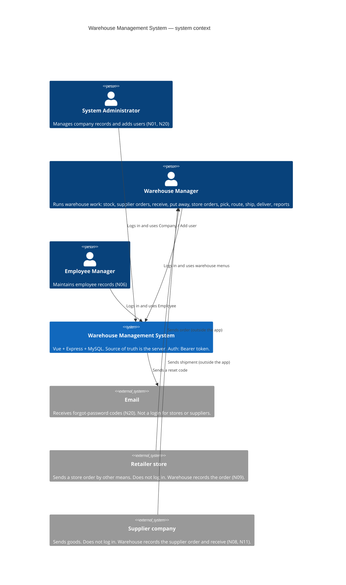

# C4 Level 1 — System context

Who talks to the Warehouse Management System. People who **do not** get a login are outside the system.

**Not in this picture**

- A store app or supplier portal
- GPS, drivers, or trucks as software systems
- Multi-region hosting
