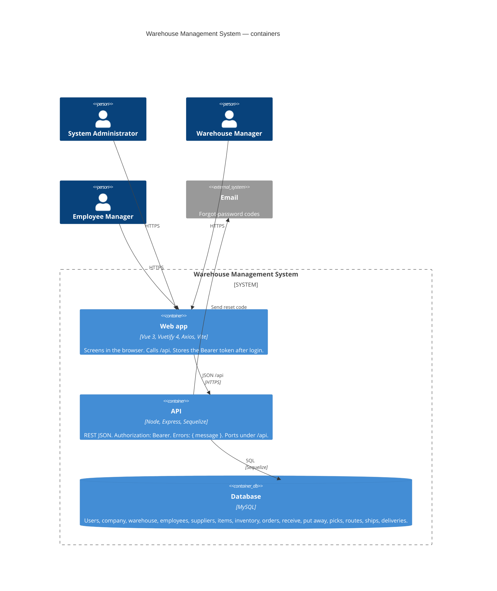

# C4 Level 2 — Containers

How the system is split to run. Stack: Vue 3 + Vuetify, Express, Sequelize, MySQL.

| Container | Lives in the repo | Notes |
|-----------|-------------------|--------|
| Web app | `frontend/` | Views, `*Services.js`, router |
| API | `backend/` | Routes, controllers, models, auth |
| Database | MySQL (`DB_NAME`) | Schema from feature Data Model sections |

Dev ports (project structure): frontend **8082**, API **3200**.
