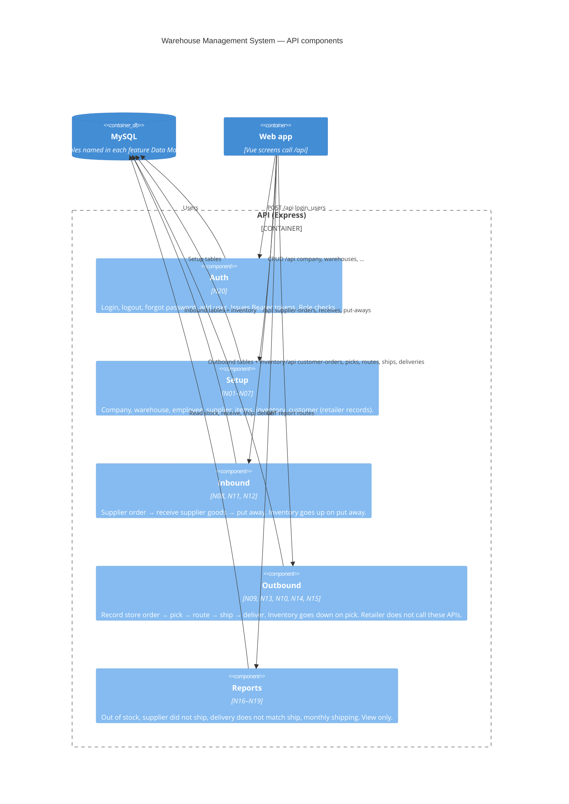
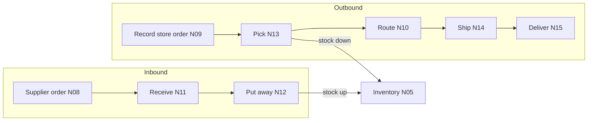

# C4 Level 3 — API components

Inside the Express API. Groups follow the [feature catalog](../../features/README.md) build order, not extra modules.

## Operational flow (same as the catalog)

## What this level does not decide

Column choices such as supplier number, warehouse on an order, order lines, or stores on a route belong in the feature Data Model. This diagram only changes if a new system or container is added.
