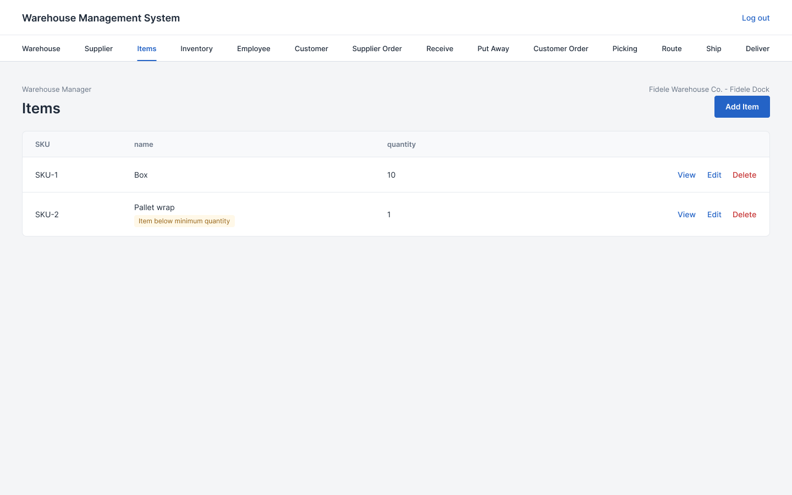
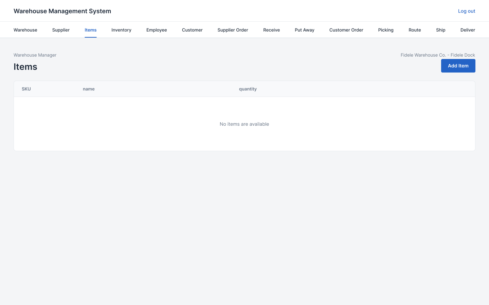
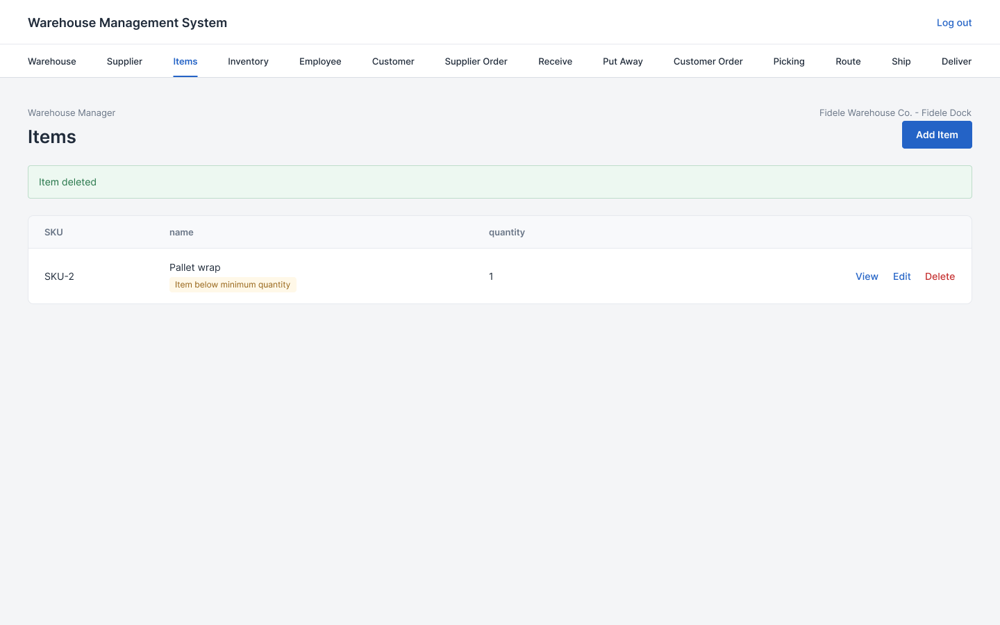
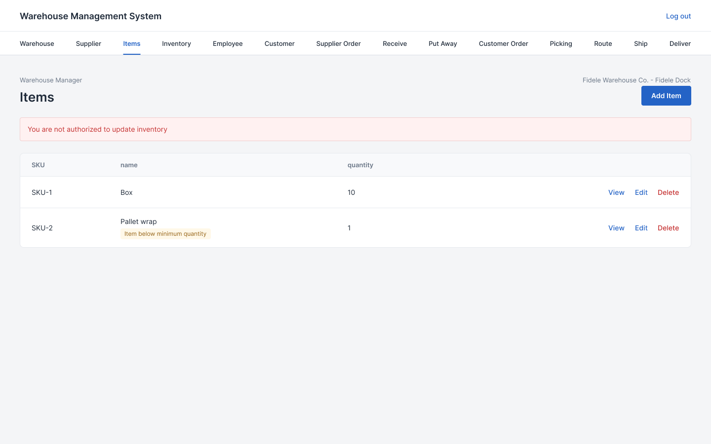
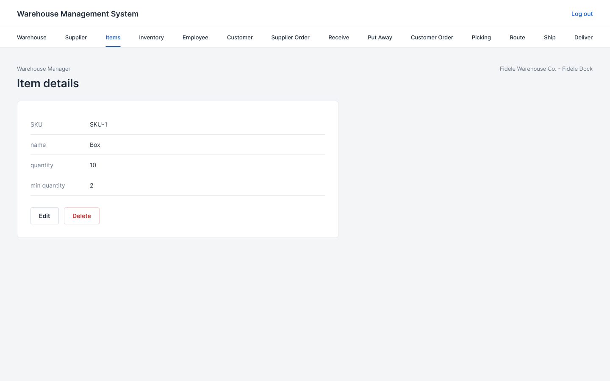
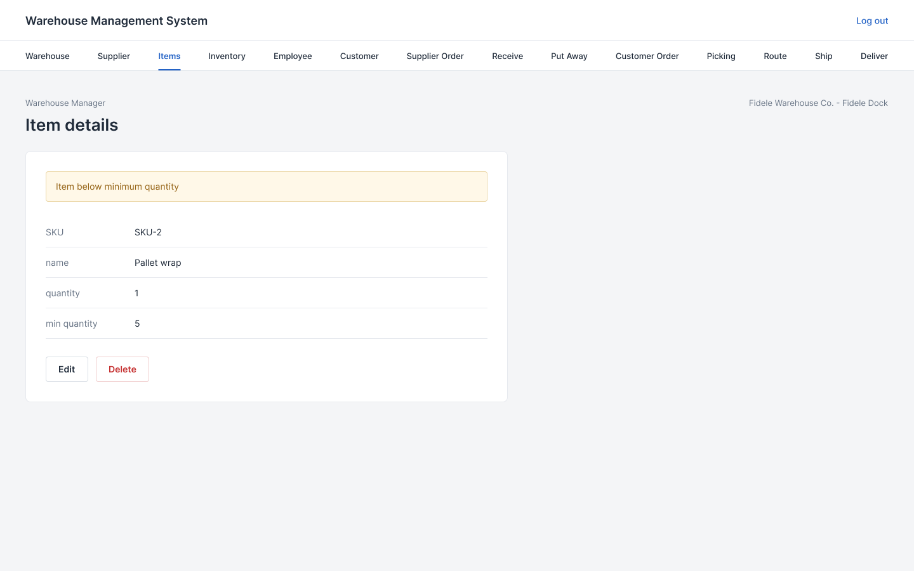
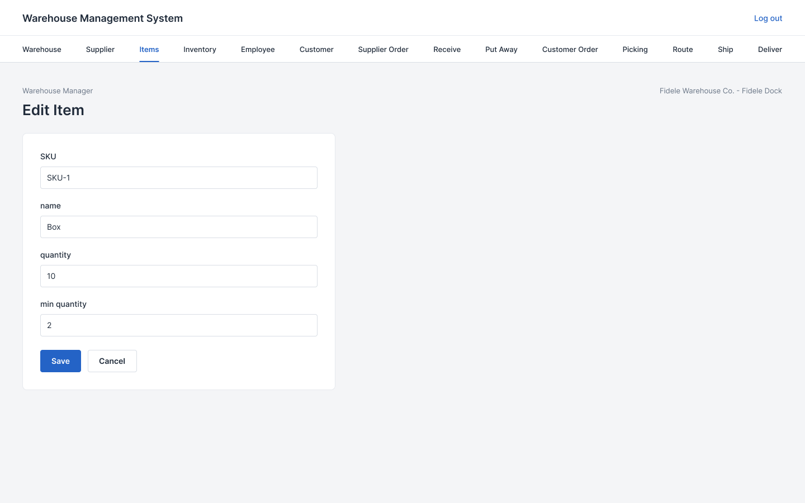

# Feature: Items

**Feature ID:**        N04  
**Branch pattern:**    `feature/4-items`  
**Status:**            Draft  
**Created:**           2026-09-21  
**Input:**             Creating, updating, inspecting, and archiving individual items in the product catalog.  
**Build order:**        6 of 20  
**Depends on:**        [Warehouse](feature_02_Warehouse__maintinence.md)  
**Related:**           [Inventory](feature_05_Inventory__maintinence.md) (next)

---

## User Stories

### US-N04.1: View Live Stock level
**As a**       a Warehouse Manager /System User  
**I want to**  View detailed information about a specific Item(SKU,UPC,Price,Supplier,Description)  
**So that**   I can identify products correctly across operations.  
**Priority:**               P1  
**Independent test:**       Select an item from the catalog; verify SKU,UPC, PRICE ,Supplier details and description display accurately.  
**Acceptance scenarios:**   See AC-N04.1

### US-N04.2: Maintain Catalog Items
**As a**       an authorized Administrator/Purchasing Managing  
**I want to**  Add new items, edit item details, or archive obsolete items  
**So that**   The item catalog stays accurate and up to date  
**Priority:**              P1  
**Independent test:**      If an item is added, edited, or deleted I can view the updates.  
**Acceptance scenarios:**  See AC-N04.2

### US-N04.3: Automated warning
**As a**        Application  
**I want to**   Display the warning message  
**When**        The item is below the minimum.  
**So that**     They can order the items needed to be to the maximum level.  
**Priority:**             P1  
**Independent test:**     when the item is below the minimum , the system gives the warning message.  
**Acceptance scenarios:** See AC-N04.3

---

## Functional Requirements

- **FR-001**: System Must display the current Stock quantity of each item in a warehouse.
- **FR-002**: System MUST allow the authorised warehouse manager to add, edit and delete the item.
- **FR-003**: the system Must give the warning to the warehouse manager when given type of the item goes below the minimum quantity.
- **FR-004**: System Must prevent unauthorized users from adding, editing, or deleting an item.

---

## Key Entities

- **Item**: a stocked product with SKU, UPC, quantity, and min/max thresholds.
- **Inventory**: the stock collection that contains items.

---

## Data Model Requirements

### `Item` table

 `item_id`          : this the unique id for the item  
 `sku`              : unique inventory item code  
 `upc`              : unique inventory item code  
 `item_name`        : this is the name of an item  
 `Max_quantity`     : maximum quantity for the item  
 `Min_quantity`     : this is the minimum quantity

---

## Acceptance Criteria

### AC-N04.1 — View Live Stock Level

#### Scenario: View Current Stock
*   **Given** the warehouse manager is using the warehouse System
*   **When**  the warehouse manager selects View Items
*   **Then**  the system displays all items
*   **And**   the system displays the current quantity of each item

#### Scenario: No Items in the stock
*   **Given** There is no items in the inventory
*   **When**  The warehouse manager selects View the Item
*   **Then**  the item list is empty
*   **And**   the system displays "No item is available"

### AC-N04.2 — Update the Stock

#### Scenario: Add an Item
*   **Given** the warehouse manager is authorized
*   **When**  The manager adds a new item and its quantity
*   **Then**  The System Saves the item
*   **And**   The updated item appears in the inventory

#### Scenario: Edit an Item
*   **Given** An item already exists in the inventory
*   **When**  The warehouse manager edits the item or its quantity
*   **Then**  The System saves and displays the updated information

#### Scenario: Delete an Item
*   **Given** An item already exists in the inventory
*   **When**  The warehouse manager deletes the item
*   **Then**  The item is removed from the inventory
*   **And**   the system displays "Item deleted"

#### Scenario: Unauthorized update
*   **Given** The user is not authorized to update inventory
*   **When**  The user tries to add, edit, or delete an item
*   **Then**  the item is not changed
*   **And**   the system displays "You are not authorized to update inventory"

### AC-N04.3 — Automated Warning

#### Scenario: Item is below minimum quantity
*   **Given**  An item has a defined minimum quantity
*   **When**  The Item's current quantity goes below the minimum quantity
*   **Then**  The System displays a warning to the warehouse Manager
*   **And**   the system displays "Item below minimum quantity"
*   **And**   The warning identifies the item that needs to be restocked

#### Scenario: Item is not below minimum quantity
*   **Given** An item a defined minimum quantity
*   **When**  The item's current quantity is equal to or above the minimum quantity
*   **Then**  The System does not display a low-stock warning

---

## Assumptions

- The user is logged in as Warehouse Manager.
- An item belongs to warehouse stock.
- Warning shows when quantity is below the minimum.

---

## Edge Cases

- Quantity below the minimum
- Quantity at or above the minimum
- User is not authorized
- List is empty

---

## Success Criteria

- **SC-001**: Warehouse Manager can add, edit, and delete an item.
- **SC-002**: Quantity below minimum shows "Item below minimum quantity".
- **SC-003**: Unauthorized user sees "You are not authorized to update inventory".

---

## Data Ownership & Isolation

Item records belong to the warehouse. Only a logged in Warehouse Manager can change them.

| Rule | Requirement |
|------|-------------|
| **Read scope** | Warehouse Manager can view items and quantities |
| **Write scope** | Warehouse Manager can add, edit, delete |
| **Create scope** | New item is created by the signed-in Warehouse Manager |
| **Cross-user access** | Missing item → `404`. Forbidden → "You are not authorized to update inventory" |
| **UI scope** | Item menu after login |
| **Implementation** | Auth on `/api/items` |

---

## API Requirements

Base path: `/api`. Errors: `{ "message": "..." }`. Auth: `Authorization: Bearer <token>`.

| Method | Endpoint | Auth | Purpose |
|--------|----------|------|---------|
| `GET` | `/api/items` | Yes | List items |
| `GET` | `/api/items/:id` | Yes | View one item |
| `POST` | `/api/items` | Yes | Add an item |
| `PUT` | `/api/items/:id` | Yes | Edit an item |
| `DELETE` | `/api/items/:id` | Yes | Delete an item |

**Create body:** `{ "sku": "SKU-1", "name": "Box", "quantity": 10, "min_quantity": 2 }`  
**Delete success:** `{ "message": "Item deleted" }`  
**Low stock:** `{ "message": "Item below minimum quantity" }`  
**Unauthorized:** `401` `{ "message": "You are not authorized to update inventory" }`

---

## Screen Requirements

Menu after login: **Items**. Warehouse Manager. No Company menu on this role.

Pictures: [`docs/ui/feature-04/`](../ui/feature-04/)

### Item list
- Heading: Items
- Button: **Add Item**
- List: SKU, name, quantity
- Warning when quantity is below minimum
- On a row: View, Edit, Delete

Empty: "No items are available"

After delete: "Item deleted"

Not allowed: "You are not authorized to update inventory"

### Add Item
- Fields: SKU, name, quantity, min quantity
- Buttons: **Save**, **Cancel**

### Item details
- Shows item information and quantity
- Buttons: **Edit**, **Delete**

Below minimum: "Item below minimum quantity"

### Edit Item
- Same fields as Add
- Buttons: **Save**, **Cancel**

---

## Definition of Done

- [ ] Add, edit, delete, and low-stock warning match the Gherkin
- [ ] Unauthorized user cannot change an item

---

## Out of Scope

- A retailer adding an item from a store login
- Coding the app (that is later)

