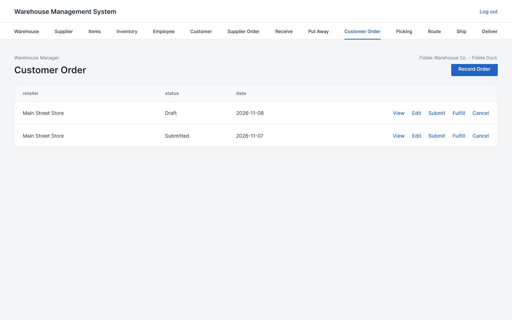
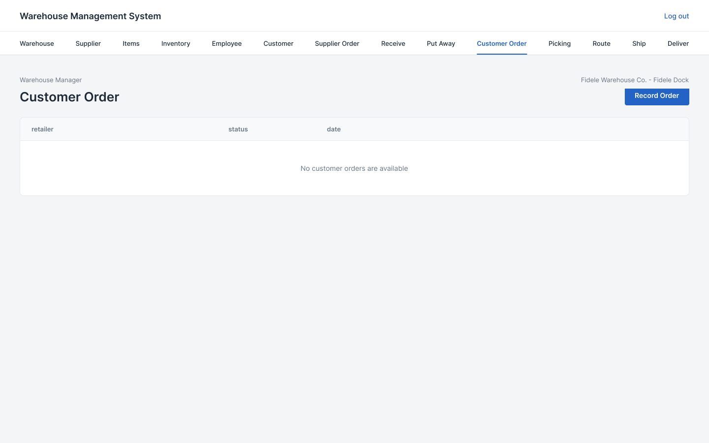
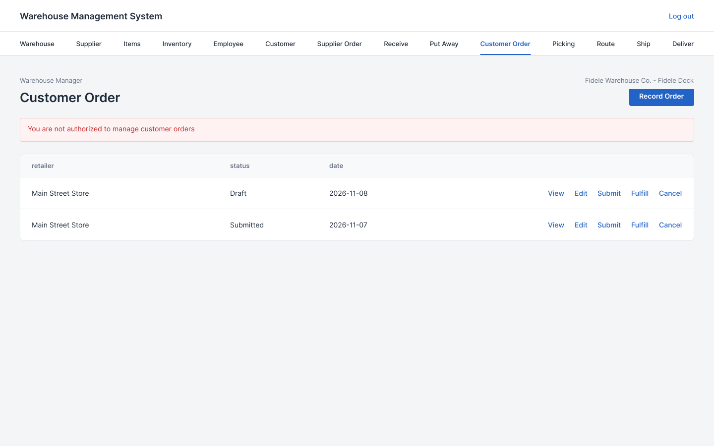
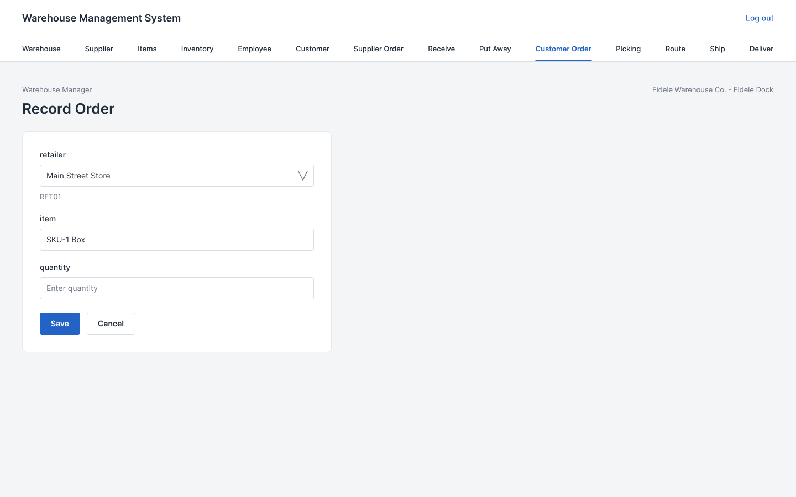
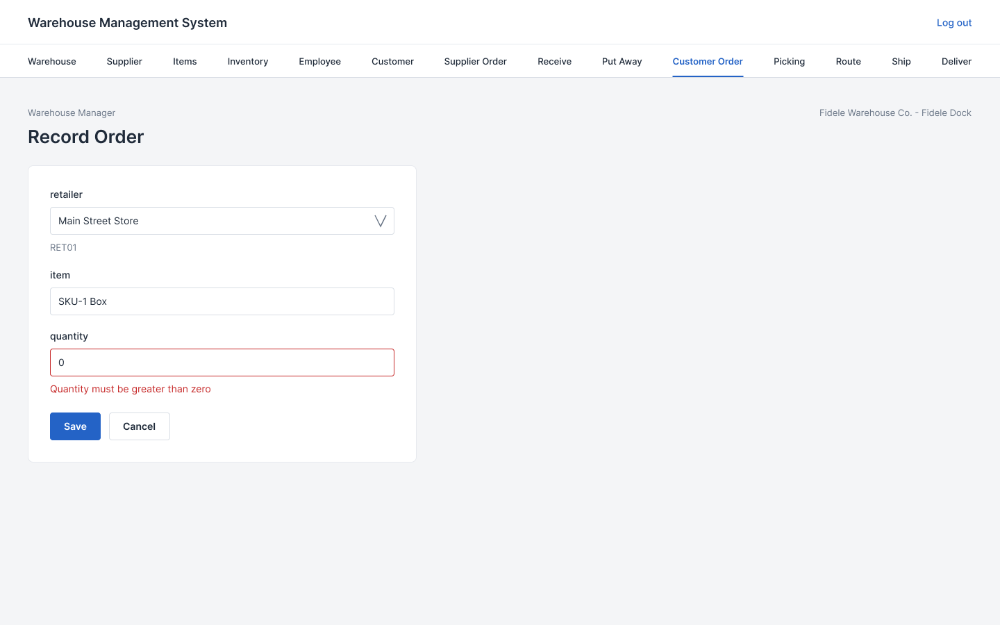
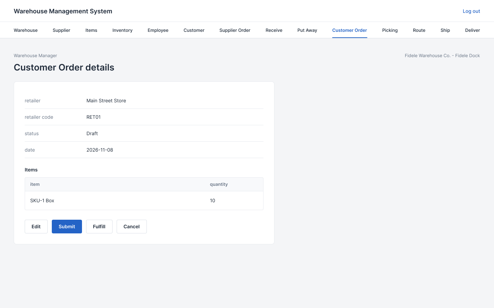
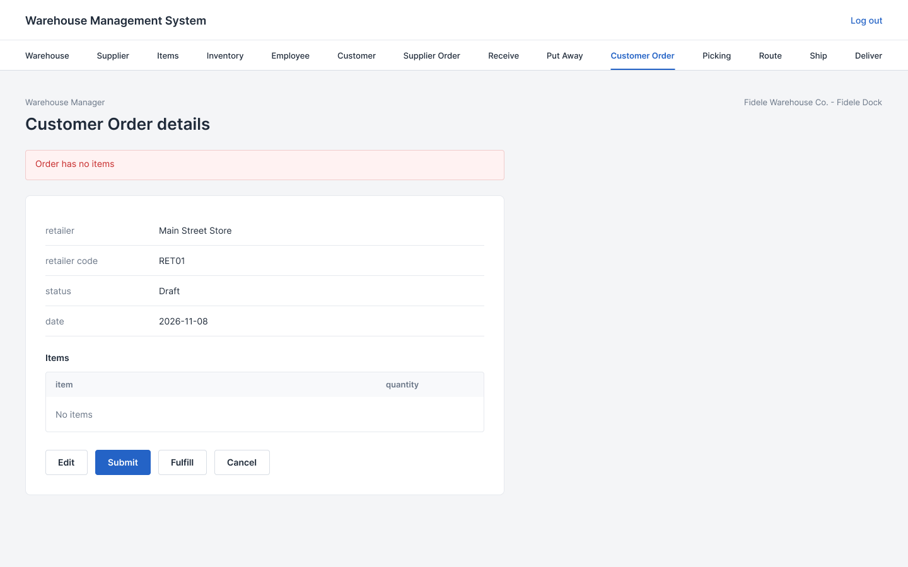
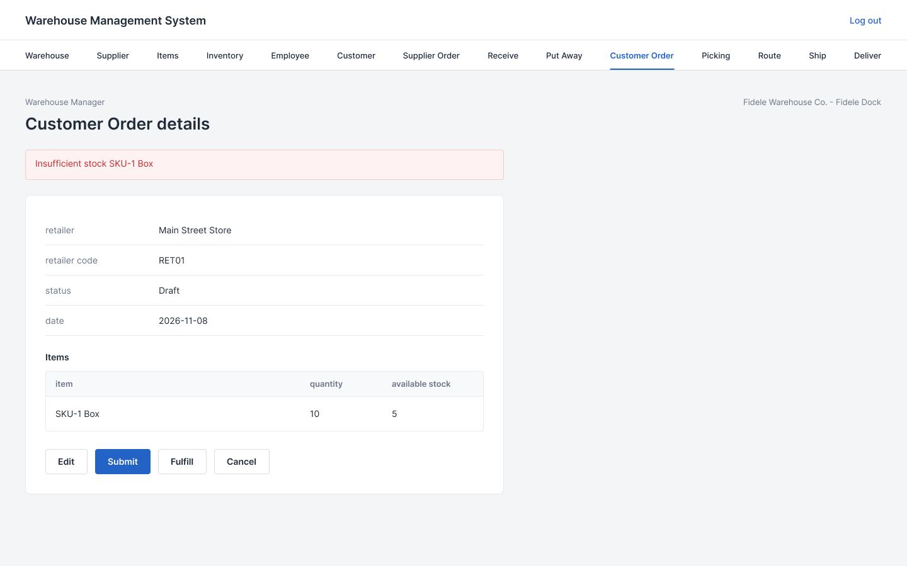
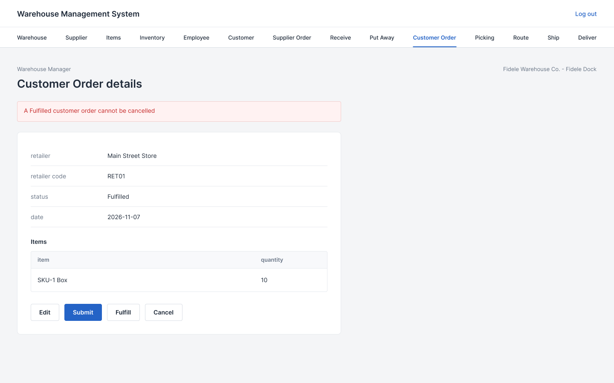
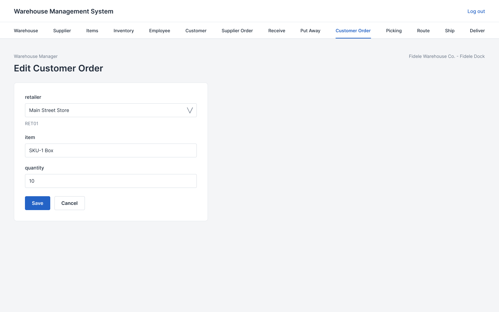

# Feature: Customer Order

**Feature ID:**        N09  
**Branch pattern:**    `feature/9-customer-order`  
**Status:**            Draft  
**Created:**           2026-10-02  
**Input:**             Record, view, edit, submit, fulfill, and cancel orders that retailers send. Retailers do not log in. The warehouse records each order.  
**Build order:**        12 of 20  
**Depends on:**        [Customer](feature_07_Customer__maintinence.md), [Items](feature_04_Items__maintinence.md), [Inventory](feature_05_Inventory__maintinence.md)  
**Related:**           [Picking](feature_13_picking.md) (next)

---

## User Stories

### US-N09.1: Record a retailer order
**As a**       Warehouse Manager  
**I want to**  record an order a retailer sent  
**So that**    the warehouse has the store's items and quantities and can prepare the order  
**Priority:**             P1  
**Independent test:**     Record an order a retailer sent for 10 units of an item for an Active retailer; the order is saved as Draft with the correct retailer, item, and quantity.  
**Acceptance scenarios:** See AC-N09.1

### US-N09.2: View customer orders
**As a**       Warehouse Manager  
**I want to**  view customer orders  
**So that**    I can see what retailers sent and the status of each order  
**Priority:**             P1  
**Independent test:**     Create a customer order; it appears in the order list with its status.  
**Acceptance scenarios:** See AC-N09.2

### US-N09.3: Edit customer order
**As a**       Warehouse Manager  
**I want to**  edit an order before it is submitted  
**So that**    incorrect order information can be corrected  
**Priority:**             P1  
**Independent test:**     Change an order quantity from 10 to 12; the updated quantity is saved.  
**Acceptance scenarios:** See AC-N09.3

### US-N09.4: Submit customer order
**As a**       Warehouse Manager  
**I want to**  submit a completed order  
**So that**    the order is confirmed and ready to be fulfilled  
**Priority:**             P1  
**Independent test:**     Submit a Draft order whose items are all in stock; its status changes to Submitted.  
**Acceptance scenarios:** See AC-N09.4

### US-N09.5: Fulfill customer order
**As a**       Warehouse Manager  
**I want to**  mark a submitted order as fulfilled  
**So that**    stock levels are reduced to reflect the items sent to the retailer store  
**Priority:**             P1  
**Independent test:**     Fulfill a Submitted order for 10 units of an item with 50 in stock; the status becomes Fulfilled and the item's stock becomes 40.  
**Acceptance scenarios:** See AC-N09.5

### US-N09.6: Cancel customer order
**As a**       Warehouse Manager  
**I want to**  cancel an order that will not be fulfilled  
**So that**    the list only shows orders that are still active  
**Priority:**             P2  
**Independent test:**     Cancel a Draft or Submitted order; its status changes to Cancelled and stock is unchanged.  
**Acceptance scenarios:** See AC-N09.6

---

## Functional Requirements

- **FR-001**: The system MUST assign every customer order a unique identifier.
- **FR-002**: The system MUST associate each order with an Active retailer (customer).
- **FR-003**: The system MUST allow authorized warehouse users to record and view orders that retailers sent.
- **FR-004**: The system MUST record the items and quantities being ordered.
- **FR-005**: The system MUST allow only Draft orders to be edited.
- **FR-006**: The system MUST maintain the order status (Draft, Submitted, Fulfilled, Cancelled).
- **FR-007**: The system MUST reject order items with a quantity of zero or less.
- **FR-008**: The system MUST NOT allow an order with no items to be submitted.
- **FR-009**: The system MUST reject submission if any item's requested quantity exceeds its current stock.
- **FR-010**: The system MUST reduce each item's stock by the ordered quantity when an order is fulfilled.
- **FR-011**: The system MUST allow Draft and Submitted orders to be cancelled, and MUST NOT allow Fulfilled orders to be cancelled.
- **FR-012**: The system MUST prevent unauthorized users from recording, editing, submitting, fulfilling, or cancelling customer orders.
- **FR-013**: The system MUST NOT require a retailer to log in. The warehouse records the order after the retailer sends it.
- **FR-014**: The system MUST store which warehouse the customer order is for (`warehouse_id`).

### Status transitions
- Draft → Submitted (when the recorded store order is submitted)
- Submitted → Fulfilled (when the order is fulfilled)
- Draft → Cancelled
- Submitted → Cancelled
- Fulfilled cannot be cancelled
- After Fulfilled, picking is N13, shipping is N14, and delivery is N15

---

## Key Entities

- **Customer Order**: an order a retailer sent that the warehouse recorded. Contains one or more Order Items.
- **Customer**: a retailer store (see N07). One retailer can have many Customer Orders. The retailer does not log in.
- **Order Item**: one line of an order: an Inventory Item and the quantity ordered. Belongs to one Customer Order.
- **Inventory Item**: a stocked item (see N04) that can be ordered.
- **Warehouse Manager**: the authorized user who records and manages retailer orders.

---

## Data Model Requirements

### `customer_order` table

 `order_id`     : This is the unique identity for the order  
 `order_code`   : this is the unique code  
 `warehouse_id` : the warehouse this order is for  
 `customer_id`  : the retailer store that sent the order  
 `status`       : Draft, Submitted, Fulfilled, or Cancelled  
 `created_at`   : this is the time it was created  
 `updated_at`   : this is the time the order was updated  
 `submitted_at` : this is the time the order was submitted  
 `fulfilled_at` : this is the time the order was fulfilled

### `customer_order_line` table

 `line_id`           : unique id for the line  
 `order_id`          : the customer order this line belongs to  
 `item_id`           : the item ordered  
 `ordered_quantity`  : how many units the store ordered

---

## Acceptance Criteria

### AC-N09.1 — Record a Retailer Order

#### Scenario: Record order
* **Given** an Active retailer exists
* **When**  the Warehouse Manager records an order the retailer sent with valid items and quantities
* **Then**  the system saves the order with status Draft
* **And**   assigns it a unique identifier
* **And**   associates the order with that retailer

#### Scenario: Invalid quantity
* **Given** the Warehouse Manager is recording an order a retailer sent
* **When**  the quantity is zero or less
* **Then**  the order item is not saved
* **And**   the system displays "Quantity must be greater than zero"

#### Scenario: Inactive retailer
* **Given** a retailer has status Inactive
* **When**  the Warehouse Manager tries to record an order for that retailer
* **Then**  the order is not recorded
* **And**   the system displays "Customer is not active"

### AC-N09.2 — View Customer Orders

#### Scenario: View orders
* **Given** customer orders exist
* **When**  the Warehouse Manager selects "View Customer Orders"
* **Then**  the system displays the orders with their customers and current statuses

#### Scenario: No orders
* **Given** no customer orders exist
* **When**  the Warehouse Manager selects "View Customer Orders"
* **Then**  the customer order list is empty
* **And**   the system displays "No orders are available"

### AC-N09.3 — Edit Customer Order

#### Scenario: Edit Draft order
* **Given** a customer order has Draft status
* **When**  the Warehouse Manager changes the order
* **Then**  the system saves the updated information

#### Scenario: Edit non-Draft order
* **Given** a customer order has status Submitted, Fulfilled, or Cancelled
* **When**  the Warehouse Manager tries to edit it
* **Then**  the order is not changed
* **And**   the system displays "Only a Draft customer order can be edited"

### AC-N09.4 — Submit Customer Order

#### Scenario: Submit order
* **Given** a Draft order has at least one item and enough stock for every item
* **When**  the Warehouse Manager submits the order
* **Then**  the status changes to Submitted

#### Scenario: Insufficient stock
* **Given** a Draft order requests more of an item than is in stock
* **When**  the Warehouse Manager submits the order
* **Then**  the status stays Draft
* **And**   the system displays "Insufficient stock"
* **And**   the message identifies the item with insufficient stock

#### Scenario: Submit empty order
* **Given** a Draft order has no items
* **When**  the Warehouse Manager tries to submit it
* **Then**  the status stays Draft
* **And**   the system displays "Order has no items"

### AC-N09.5 — Fulfill Customer Order

#### Scenario: Fulfill order
* **Given** an order has status Submitted
* **When**  the Warehouse Manager fulfills the order
* **Then**  the status changes to Fulfilled
* **And**   each item's stock is reduced by the ordered quantity

#### Scenario: Fulfillment triggers low-stock warning
* **Given** fulfilling an order brings an item's quantity below its minimum
* **When**  the order is fulfilled
* **Then**  the system displays "Item below minimum quantity"
* **And**   the warning is the same warning defined in N05

#### Scenario: Fulfill non-Submitted order
* **Given** an order has status Draft, Fulfilled, or Cancelled
* **When**  the Warehouse Manager tries to fulfill it
* **Then**  the order status is not changed
* **And**   the system displays "Only a Submitted customer order can be fulfilled"

### AC-N09.6 — Cancel Customer Order

#### Scenario: Cancel order
* **Given** an order has status Draft or Submitted
* **When**  the Warehouse Manager cancels it
* **Then**  the status changes to Cancelled
* **And**   stock levels are unchanged

#### Scenario: Cancel Fulfilled order
* **Given** an order has status Fulfilled
* **When**  the Warehouse Manager tries to cancel it
* **Then**  the order status stays Fulfilled
* **And**   the system displays "A Fulfilled customer order cannot be cancelled"

#### Scenario: Unauthorized change
* **Given** the user is not authorized to manage customer orders
* **When**  they try to record, edit, submit, fulfill, or cancel an order
* **Then**  the customer order is not changed
* **And**   the system displays "You are not authorized to manage customer orders"

---

## Assumptions

- The user is logged in as Warehouse Manager.
- The retailer does not log in. The warehouse records the store order.
- Status can be Draft, Submitted, Fulfilled, or Cancelled.

---

## Edge Cases

- Fulfill when the order is not Submitted
- Cancel when the order is Fulfilled
- User is not authorized
- List is empty

---

## Success Criteria

- **SC-001**: Warehouse Manager can record, edit, submit, fulfill, and cancel a customer order.
- **SC-002**: Fulfilled orders cannot be cancelled.
- **SC-003**: Unauthorized user sees "You are not authorized to manage customer orders".

---

## Data Ownership & Isolation

Customer orders belong to the warehouse. The retailer store has no login.

| Rule | Requirement |
|------|-------------|
| **Read scope** | Warehouse Manager can view recorded store orders |
| **Write scope** | Warehouse Manager can record, edit, submit, fulfill, cancel |
| **Create scope** | New order is recorded by the signed-in Warehouse Manager |
| **Cross-user access** | Missing order → `404`. Forbidden → "You are not authorized to manage customer orders" |
| **UI scope** | Customer Order menu after login |
| **Implementation** | Auth on `/api/customer-orders` |

---

## API Requirements

Base path: `/api`. Errors: `{ "message": "..." }`. Auth: `Authorization: Bearer <token>`.

| Method | Endpoint | Auth | Purpose |
|--------|----------|------|---------|
| `GET` | `/api/customer-orders` | Yes | List customer orders |
| `GET` | `/api/customer-orders/:id` | Yes | View one order |
| `POST` | `/api/customer-orders` | Yes | Record a store order |
| `PUT` | `/api/customer-orders/:id` | Yes | Edit a Draft order |
| `POST` | `/api/customer-orders/:id/submit` | Yes | Submit |
| `POST` | `/api/customer-orders/:id/fulfill` | Yes | Fulfill |
| `POST` | `/api/customer-orders/:id/cancel` | Yes | Cancel |

**Create body:** `{ "customer_id": 1, "items": [{ "item_id": 1, "quantity": 5 }] }`  
**Bad fulfill:** `400` `{ "message": "Only a Submitted customer order can be fulfilled" }`  
**Bad cancel:** `400` `{ "message": "A Fulfilled customer order cannot be cancelled" }`  
**Unauthorized:** `401` `{ "message": "You are not authorized to manage customer orders" }`

---

## Screen Requirements

Menu after login: **Customer Order**. Warehouse Manager. Retailer does not log in. Warehouse records the store order.

Pictures: [`docs/ui/feature-09/`](../ui/feature-09/)

### Customer order list
- Heading: Customer Order
- Button: **Record Order**
- List: retailer, status, date
- On a row: View, Edit, Submit, Fulfill, Cancel

Empty: "No customer orders are available"

Not allowed: "You are not authorized to manage customer orders"

### Record Order
- Fields: retailer, items, quantities
- Buttons: **Save**, **Cancel**

Quantity zero or less: "Quantity must be greater than zero"

### Customer order details
- Shows items and status
- Buttons: **Edit**, **Submit**, **Fulfill**, **Cancel**

Empty order: "Order has no items"

Not enough stock: "Insufficient stock"

Not Draft: "Only a Draft customer order can be edited"

Cancel Fulfilled: "A Fulfilled customer order cannot be cancelled"

### Edit Customer Order
- Same fields as Record (Draft only)
- Button: **Save**

---

## Definition of Done

- [ ] Record, submit, fulfill, and cancel match the Gherkin
- [ ] Retailer has no store login on this screen

---

## Out of Scope

- A retailer submitting an order from a store login
- Coding the app (that is later)

