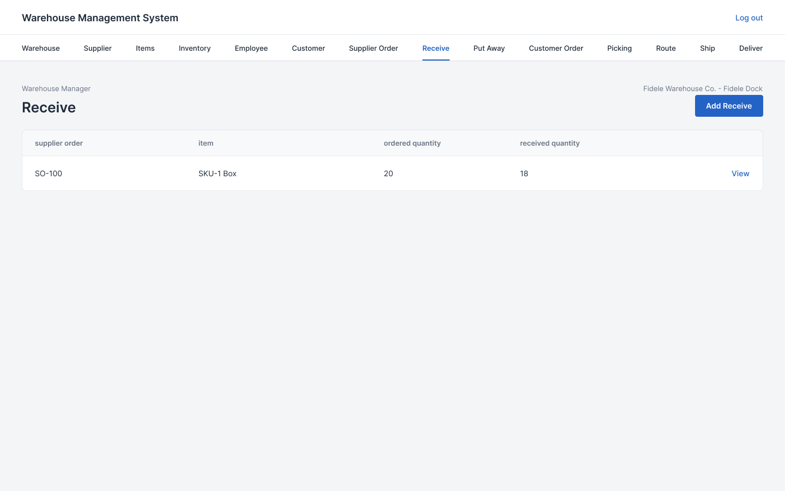
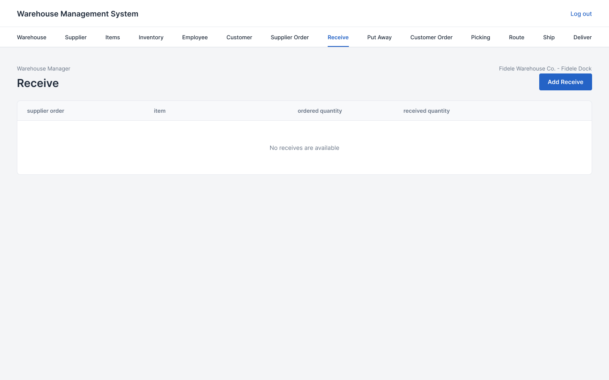
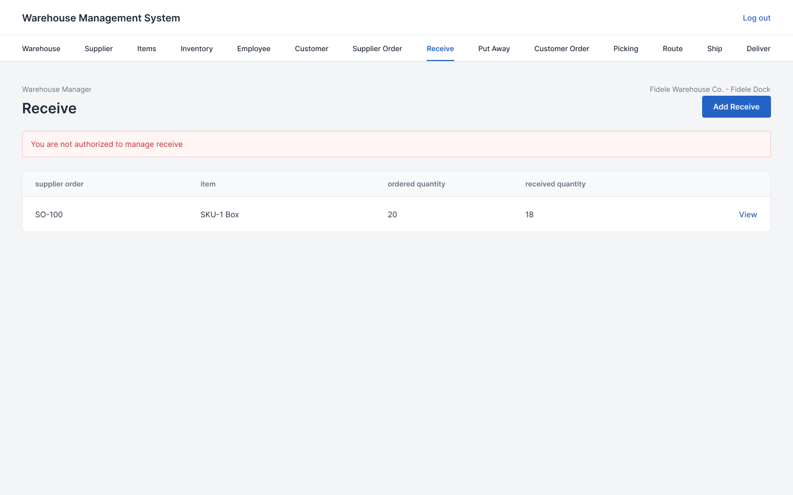
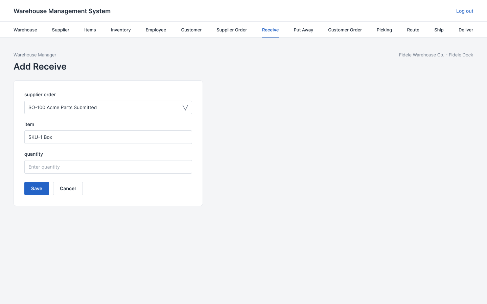
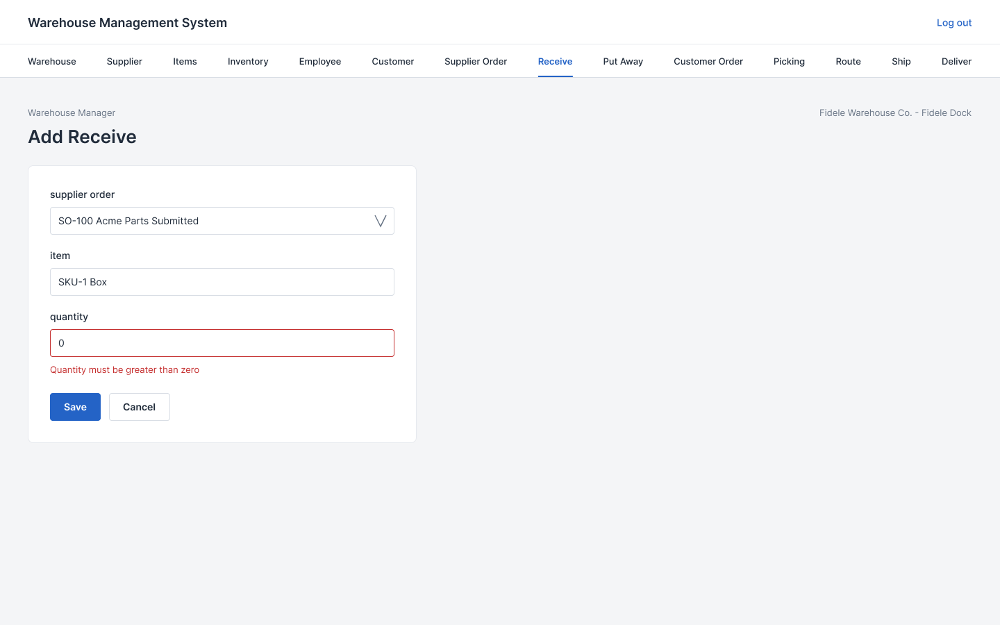
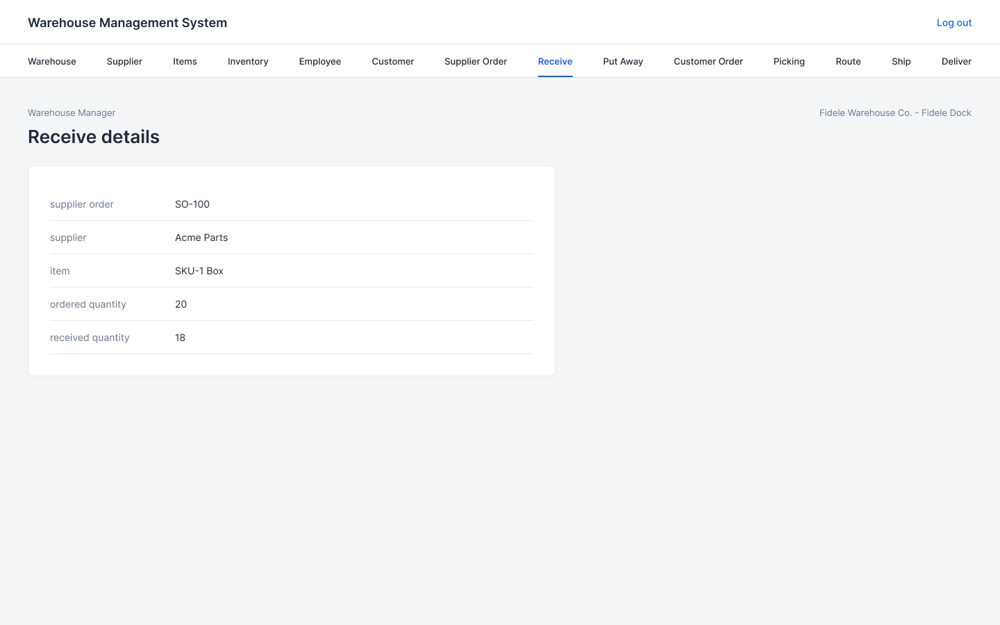

# Feature: Receiving

**Feature ID:**        N11  
**Branch pattern:**    `feature/11-receiving`  
**Status:**            Draft  
**Created:**           2026-19-10  
**Input:**             Receiving items that arrive from a supplier order.
**Build order:**        10 of 20  
**Depends on:**        [Supplier Order](feature_08_Supplier_order_Management.md), [Warehouse](feature_02_Warehouse__maintinence.md), [Items](feature_04_Items__maintinence.md)  
**Related:**           [Put Away](feature_12_put_away.md) (next)
---

## User Stories

### US-N.11.1: View lines waiting to receive
**As a**        Warehouse Manager
**I want to**   see each Submitted supplier-order line for my warehouse (item, ordered quantity)
**So that**     I know what should arrive on the dock.
**Priority:**               P1  
**Independent test:**    Submit a supplier order with two lines. View Receive shows both items and ordered quantities.
**Acceptance scenarios:**   US-11.1: under the acceptance criteria

### US-N.11.2: Record received quantity per line
**As a**       Warehouse Manager
**I want to**  enter how many units arrived for each line (equal to or less than ordered)
**So that**    the warehouse has a receive record before put away, including a short shipment.

**Priority:**               P1  
**Independent test:**    For a Submitted line of 50, receive 50. The receive is saved. Receive 40 of 50 and the short quantity is recorded. Draft orders cannot be received.
**Acceptance scenarios:**   US-11.2: under the acceptance criteria

### US-N.11.3: View receive records
**As a**       Warehouse Manager
**I want to**  View receive records
**So that**    I can see supplier order, item, ordered quantity, and received quantity.

**Priority:**               P1  
**Independent test:**   Complete a receive and select View Receive records. The supplier order, item, ordered quantity, and received quantity are displayed.
**Acceptance scenarios:**   US-11.3: under the acceptance criteria

---

## Functional Requirements

- **FR-001**: System Must allow the warehouse Manager to view supplier orders that are ready to receive.
- **FR-002**: System Must allow an authorised Warehouse Manager to receive items from a Submitted supplier order.
- **FR-003**: System Must associate each receive with a supplier order and an item.
- **FR-004**: System Must reject a receive when the supplier order is not Submitted.
- **FR-005**: System Must reject a receive quantity of zero or less.
- **FR-006**: System Must allow a receive quantity that is less than the ordered quantity.
- **FR-007**: System Must record when the received quantity is not the same as the ordered quantity.
- **FR-008**: System Must set the supplier order status to Received when the receive is saved.
- **FR-009**: System Must allow an authorised Warehouse Manager to view receive records.
- **FR-010**: System Must prevent unauthorized users from creating a receive.

### Status transitions
- A supplier order must be Submitted before it can be received
- Submitted → Received when the receive is saved
- Draft and Received orders cannot be received again

---

## Key Entities

- **Receive**: recording the items that arrived from a supplier order.
- **Supplier Order**: the order being received. A Submitted supplier order can be received.
- **Supplier**: the company that sent the items.
- **Item**: the inventory item that arrived.
- **Put Away**: after receive, items are put away into a warehouse location.

- **relationships**
- one **Supplier Order** can have multiple **Receives**
- one **Item** can be in multiple **Receives**

---

## Data Model Requirements

### `Receive` table

 Field             
-------            
 `receive_id`           : this is the unique id
 `receive_code`         : this is the unique code for the receive
 `supplier_order_code`  : this is the supplier order the items came from
 `item_id`              : this is the item that arrived
 `ordered_quantity`     : this is the quantity that was ordered
 `received_quantity`    : this is the quantity that arrived
 `created_at`           : this is the time when the receive was saved

---

## Acceptance Criteria

### US-N.11.1 — View orders to receive

#### Scenario: View orders ready to receive
*   **Given** a Submitted supplier order exists
*   **When**  the warehouse Manager selects View Receive
*   **Then**  the system displays the supplier orders that are ready to receive
*   **And**   displays the items and ordered quantity

#### Scenario: No orders to receive
*   **Given** there are no supplier orders ready to receive
*   **When**  the warehouse Manager selects View Receive
*   **Then**  the system displays "No orders are available to receive"

### US-N.11.2 — Receive supplier order

#### Scenario: Receive all ordered quantity
*   **Given** the Warehouse Manager is authorized
*   **And**   a supplier order has status Submitted
*   **When**  the manager enters the received quantity equal to the ordered quantity
*   **Then**  the system saves the receive
*   **And**   associates it with the supplier order
*   **And**   the supplier order status becomes Received

#### Scenario: Receive less than ordered
*   **Given** a supplier order has status Submitted
*   **And**   the ordered quantity is 50
*   **When**  the Warehouse Manager receives 40
*   **Then**  the system saves the receive
*   **And**   records that the received quantity is not the same as the ordered quantity
*   **And**   the supplier order status becomes Received

#### Scenario: Supplier order is not Submitted
*   **Given** a supplier order has status Draft or Received
*   **When**  the Warehouse Manager tries to receive that order
*   **Then**  the receive is not saved
*   **And**   the system displays "Supplier order is not Submitted"

#### Scenario: Invalid receive quantity
*   **Given** the Warehouse Manager is receiving a supplier order
*   **When**  the quantity is zero or less
*   **Then**  the receive is not saved
*   **And**   the system displays "Quantity must be greater than zero"

### US-N.11.3 — View receive records

#### Scenario: View existing receives
*   **Given** receive records exist in the system
*   **When**  the warehouse Manager selects View Receive records
*   **Then**  the system displays the receives
*   **And**   displays the supplier order, item, ordered quantity, and received quantity

#### Scenario: No receive records
*   **Given** no receive records exist
*   **When**  the warehouse Manager selects View Receive records
*   **Then**  the system displays "No receives are available"

#### Scenario: Unauthorized update
*   **Given** the user is not authorized to manage receive
*   **When**  the user attempts to create a receive
*   **Then**  the receive is not saved
*   **And**   the system displays "You are not authorized to manage receive"

---

## Assumptions

- The user is logged in as Warehouse Manager.
- Receive is for goods from a supplier order, not a store order.
- Quantity must be greater than zero.

---

## Edge Cases

- Quantity zero or less
- No receive records
- User is not authorized

---

## Success Criteria

- **SC-001**: Warehouse Manager can record a receive against a supplier order.
- **SC-002**: Quantity zero or less shows "Quantity must be greater than zero".
- **SC-003**: Empty list shows "No receives are available".

---

## Data Ownership & Isolation

Receive records belong to the warehouse. The supplier does not log in to receive.

| Rule | Requirement |
|------|-------------|
| **Read scope** | Warehouse Manager can view receives |
| **Write scope** | Warehouse Manager can create a receive |
| **Create scope** | New receive is created by the signed-in Warehouse Manager |
| **Cross-user access** | Missing receive → `404`. Forbidden → "You are not authorized to manage receive" |
| **UI scope** | Receive menu after login |
| **Implementation** | Auth on `/api/receives` |

---

## API Requirements

Base path: `/api`. Errors: `{ "message": "..." }`. Auth: `Authorization: Bearer <token>`.

| Method | Endpoint | Auth | Purpose |
|--------|----------|------|---------|
| `GET` | `/api/receives` | Yes | List receives |
| `GET` | `/api/receives/:id` | Yes | View one receive |
| `POST` | `/api/receives` | Yes | Record a receive |

**Create body:** `{ "supplier_order_id": 1, "item_id": 1, "quantity": 10 }`  
**Bad quantity:** `400` `{ "message": "Quantity must be greater than zero" }`  
**Empty list:** `{ "message": "No receives are available" }`  
**Unauthorized:** `401` `{ "message": "You are not authorized to manage receive" }`

---

## Screen Requirements

Menu after login: **Receive**. Warehouse Manager. Supplier goods, not a store order.

Pictures: [`docs/ui/feature-11/`](../ui/feature-11/)

### Receive list
- Heading: Receive
- Button: **Add Receive**
- List: supplier order, item, ordered quantity, received quantity

Empty: "No receives are available"

Not allowed: "You are not authorized to manage receive"

### Add Receive
- Fields: supplier order, item, quantity
- Buttons: **Save**, **Cancel**

Quantity zero or less: "Quantity must be greater than zero"

### Receive details
- Shows supplier order, item, ordered quantity, received quantity

---

## Definition of Done

- [ ] Create and view receive match the Gherkin
- [ ] Receive is for supplier goods, not store orders

---

## Out of Scope

- Receiving a retailer store order as if it were a supplier shipment
- Coding the app (that is later)

