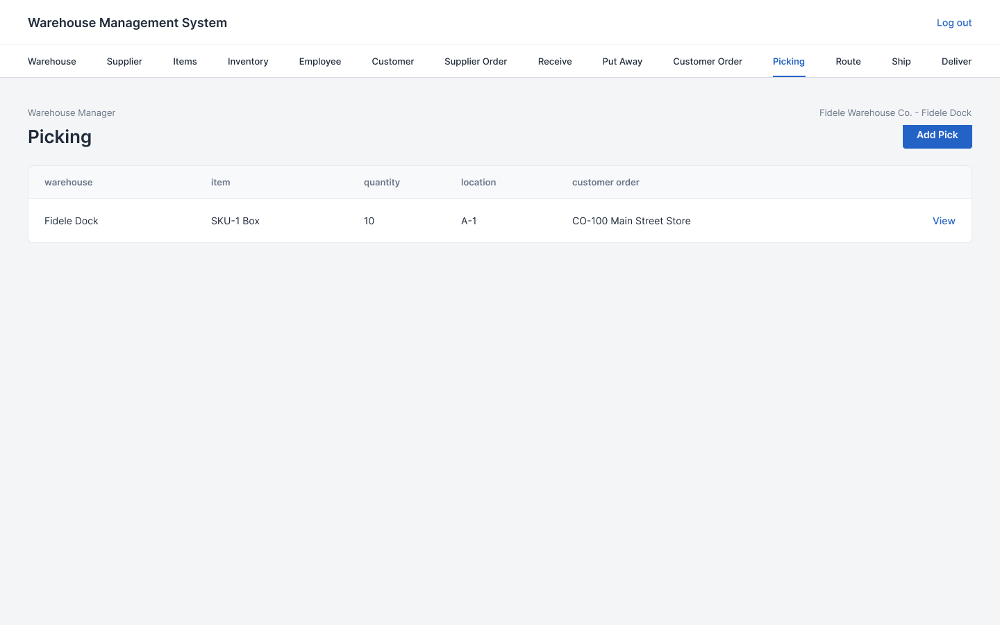
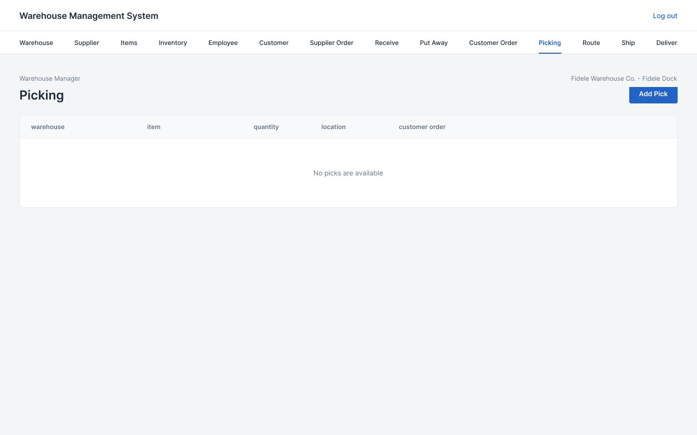
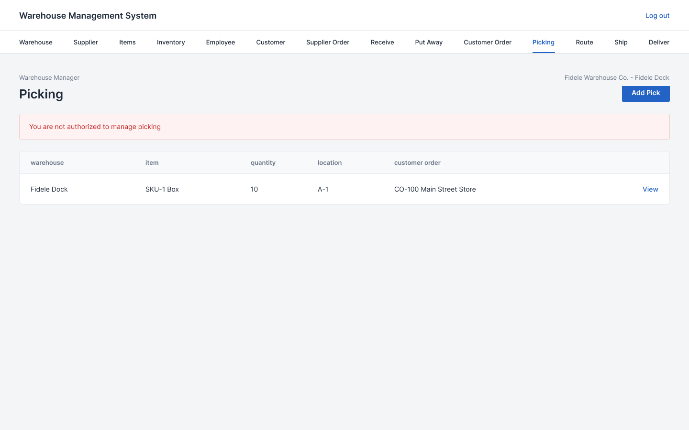
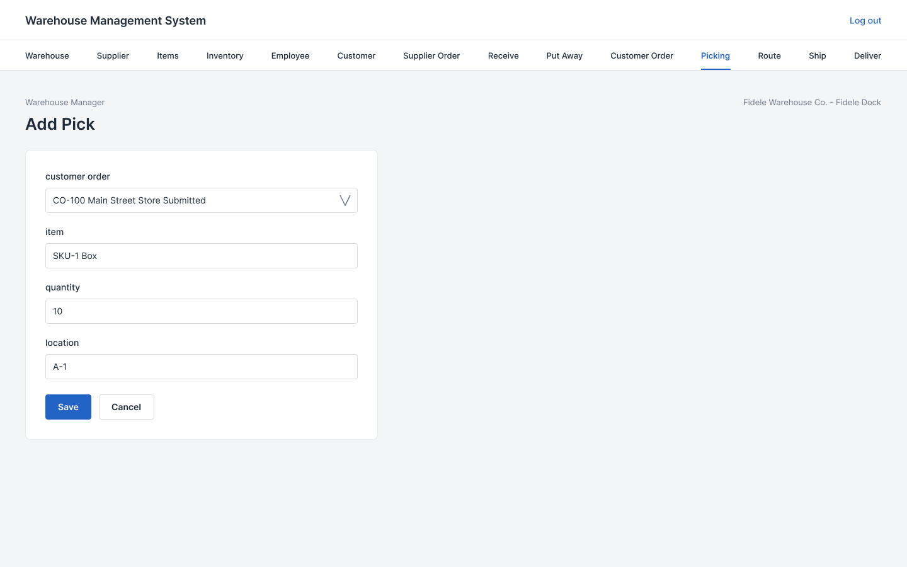
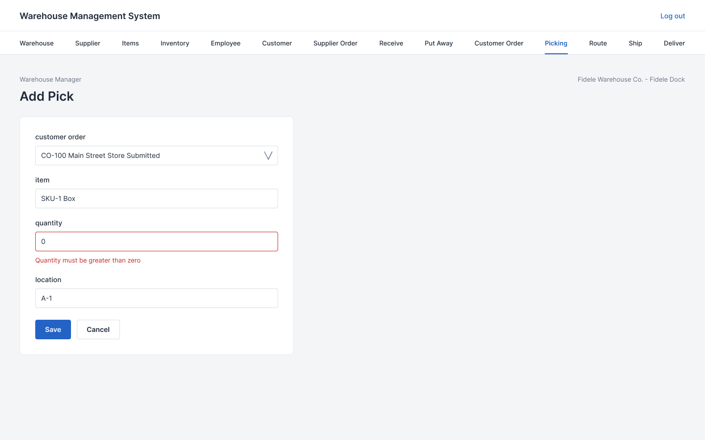
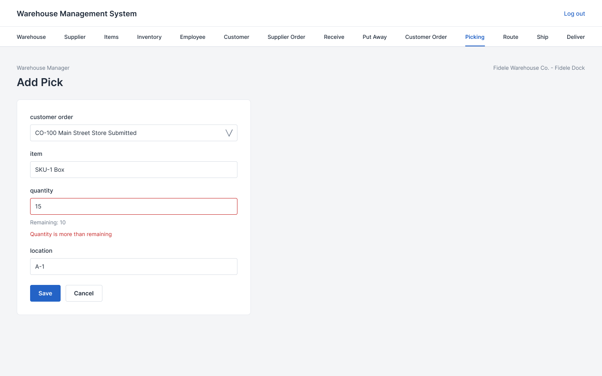
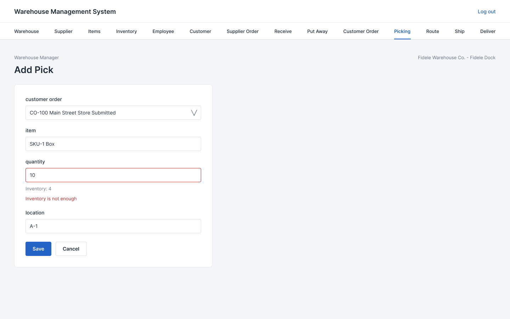
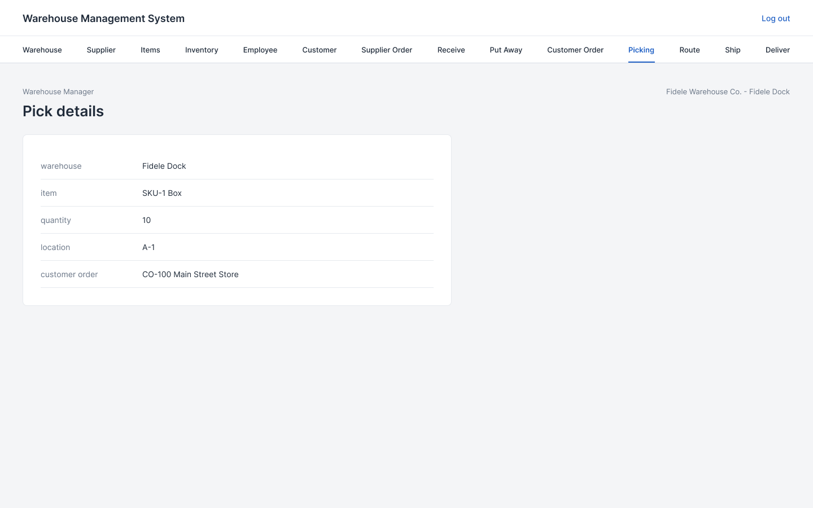

# Feature: Picking

**Feature ID:**        N13  
**Branch pattern:**    `feature/13-picking`  
**Status:**            Draft  
**Created:**           2026-19-10  
**Input:**             Picking items from a warehouse location for a retailer order the warehouse recorded and updating inventory.
**Build order:**        13 of 20  
**Depends on:**        [Customer Order](feature_09_Customer_Order_Management.md), [Inventory](feature_05_Inventory__maintinence.md)  
**Related:**           [Route](feature_10_route_maintenence.md) (next)
---

## User Stories

### US-N.13.1: View items to pick
**As a**        Warehouse Manager
**I want to**   View items that are ready to pick
**So that**     I can see what a recorded retailer order needs from the warehouse.
**Priority:**               P1  
**Independent test:**    Submit a customer order and select View Picking. The items from that order are displayed.
**Acceptance scenarios:**   US-13.1: under the acceptance criteria

### US-N.13.2: Pick items
**As a**       Warehouse Manager
**I want to**  pick items from a warehouse location
**So that**    the customer order can be prepared and the inventory is updated.

**Priority:**               P1  
**Independent test:**    Pick 10 units of an item from a Submitted customer order. The pick is saved and the inventory quantity decreases by 10.
**Acceptance scenarios:**   US-13.2: under the acceptance criteria

### US-N.13.3: View pick records
**As a**       Warehouse Manager
**I want to**  View pick records
**So that**    I can see what was taken from the warehouse for each customer order.

**Priority:**               P1  
**Independent test:**   Complete a pick and select View Picking records. The warehouse, item, quantity, location, and customer order are displayed.
**Acceptance scenarios:**   US-13.3: under the acceptance criteria

---

## Functional Requirements

- **FR-001**: System Must allow the warehouse Manager to view items that are ready to pick.
- **FR-002**: System Must allow an authorised Warehouse Manager to pick items from a Submitted customer order in a warehouse location.
- **FR-003**: System Must update the inventory quantity when a pick is saved.
- **FR-004**: System Must associate each pick with a warehouse, an item, and a customer order.
- **FR-005**: System Must reject a pick when the customer order is not Submitted.
- **FR-006**: System Must reject a pick quantity of zero or less.
- **FR-007**: System Must reject a pick quantity that is more than the quantity still not picked for that order item.
- **FR-008**: System Must reject a pick when the inventory quantity is less than the pick quantity.
- **FR-009**: System Must allow an authorised Warehouse Manager to view pick records.
- **FR-010**: System Must prevent unauthorized users from creating a pick.

---

## Key Entities

- **Pick**: taking items from a warehouse location for a customer order.
- **Customer Order**: the order the items are picked for. A Submitted customer order can have one or more picks.
- **Warehouse**: the location where the items are picked from.
- **Item**: the inventory item being picked.
- **Inventory**: the stock quantity in the warehouse. Pick decreases the quantity.
- **Put Away**: items must be in the warehouse from put away before they can be picked.
- **Route**: after the customer order is picked and fulfilled, it can be added to a delivery route.

- **relationships**
- one **Customer Order** can have multiple **Picks**
- one **Warehouse** can have multiple **Picks**
- one **Item** can be in multiple **Picks**

---

## Data Model Requirements

### `Pick` table

 Field             
-------            
 `pick_id`            : this is the unique id
 `pick_code`          : this is the unique code for the pick
 `warehouse_code`     : this is the warehouse where the items are picked from
 `item_id`            : this is the item being picked
 `quantity`           : this is the quantity taken from the location
 `location`           : this is the place in the warehouse
 `customer_order_code`: this is the customer order the items are picked for
 `created_at`         : this is the time when the pick was saved

---

## Acceptance Criteria

### US-N.13.1 — View items to pick

#### Scenario: View items ready to pick
*   **Given** a Submitted customer order has items that are not all picked
*   **When**  the warehouse Manager selects View Picking
*   **Then**  the system displays the items that still need to be picked
*   **And**   displays the remaining quantity for each item

#### Scenario: No items to pick
*   **Given** there are no items ready to pick
*   **When**  the warehouse Manager selects View Picking
*   **Then**  the system displays "No items are available to pick"

### US-N.13.2 — Pick items

#### Scenario: Pick from a customer order
*   **Given** the Warehouse Manager is authorized
*   **And**   a customer order has status Submitted
*   **And**   the inventory has enough quantity
*   **When**  the manager enters a valid warehouse location and quantity for an order item
*   **Then**  the system saves the pick
*   **And**   associates it with the warehouse and the customer order
*   **And**   the inventory quantity of that item decreases by the pick quantity

#### Scenario: Customer order is not Submitted
*   **Given** a customer order has status Draft, Fulfilled, or Cancelled
*   **When**  the Warehouse Manager tries to pick items for that order
*   **Then**  the pick is not saved
*   **And**   the system displays "Customer order is not Submitted"

#### Scenario: Invalid pick quantity
*   **Given** the Warehouse Manager is picking items
*   **When**  the quantity is zero or less
*   **Then**  the pick is not saved
*   **And**   the system displays "Quantity must be greater than zero"

#### Scenario: Quantity more than remaining
*   **Given** a Submitted customer order still has 10 units not picked
*   **When**  the Warehouse Manager tries to pick 15 units of that item
*   **Then**  the pick is not saved
*   **And**   the system displays "Quantity is more than remaining"

#### Scenario: Not enough inventory
*   **Given** a Submitted customer order needs 10 units
*   **And**   the inventory has 4 units of that item
*   **When**  the Warehouse Manager tries to pick 10 units
*   **Then**  the pick is not saved
*   **And**   the system displays "Inventory is not enough"

### US-N.13.3 — View pick records

#### Scenario: View existing picks
*   **Given** pick records exist in the system
*   **When**  the warehouse Manager selects View Picking records
*   **Then**  the system displays the picks
*   **And**   displays the warehouse, item, quantity, location, and customer order

#### Scenario: No pick records
*   **Given** no pick records exist
*   **When**  the warehouse Manager selects View Picking records
*   **Then**  the system displays "No picks are available"

#### Scenario: Unauthorized update
*   **Given** the user is not authorized to manage picking
*   **When**  the user attempts to create a pick
*   **Then**  the pick is not saved
*   **And**   the system displays "You are not authorized to manage picking"

---

## Assumptions

- The user is logged in as Warehouse Manager.
- A pick is for a customer order from a warehouse location.

---

## Edge Cases

- No pick records
- User is not authorized

---

## Success Criteria

- **SC-001**: Warehouse Manager can create a pick for a customer order.
- **SC-002**: Empty list shows "No picks are available".
- **SC-003**: Unauthorized user sees "You are not authorized to manage picking".

---

## Data Ownership & Isolation

Pick records belong to the warehouse. The retailer does not pick from a store login.

| Rule | Requirement |
|------|-------------|
| **Read scope** | Warehouse Manager can view picks |
| **Write scope** | Warehouse Manager can create a pick |
| **Create scope** | New pick is created by the signed-in Warehouse Manager |
| **Cross-user access** | Missing pick → `404`. Forbidden → "You are not authorized to manage picking" |
| **UI scope** | Picking menu after login |
| **Implementation** | Auth on `/api/picks` |

---

## API Requirements

Base path: `/api`. Errors: `{ "message": "..." }`. Auth: `Authorization: Bearer <token>`.

| Method | Endpoint | Auth | Purpose |
|--------|----------|------|---------|
| `GET` | `/api/picks` | Yes | List picks |
| `GET` | `/api/picks/:id` | Yes | View one pick |
| `POST` | `/api/picks` | Yes | Record a pick |

**Create body:** `{ "customer_order_id": 1, "item_id": 1, "quantity": 5, "location": "A-1" }`  
**Empty list:** `{ "message": "No picks are available" }`  
**Unauthorized:** `401` `{ "message": "You are not authorized to manage picking" }`

---

## Screen Requirements

Menu after login: **Picking**. Warehouse Manager. After a Submitted store order: take items off a shelf. Inventory goes down. Retailer does not log in.

Pictures: [`docs/ui/13-picking/`](../ui/13-picking/)

### Pick list
- Heading: Picking
- Button: **Add Pick**
- List: warehouse, item, quantity, location, customer order

Empty: "No picks are available"

Not allowed: "You are not authorized to manage picking"

### Add Pick
- Fields: customer order, item, quantity, location
- Buttons: **Save**, **Cancel**

Quantity zero or less: "Quantity must be greater than zero"

Quantity more than remaining: "Quantity is more than remaining"

Not enough stock: "Inventory is not enough"

### Pick details
- Shows warehouse, item, quantity, location, customer order

---

## Definition of Done

- [ ] Create and view picks match the Gherkin
- [ ] Pick is for a recorded customer order, not a retailer login

---

## Out of Scope

- A retailer picking in their store from this app
- Coding the app (that is later)

