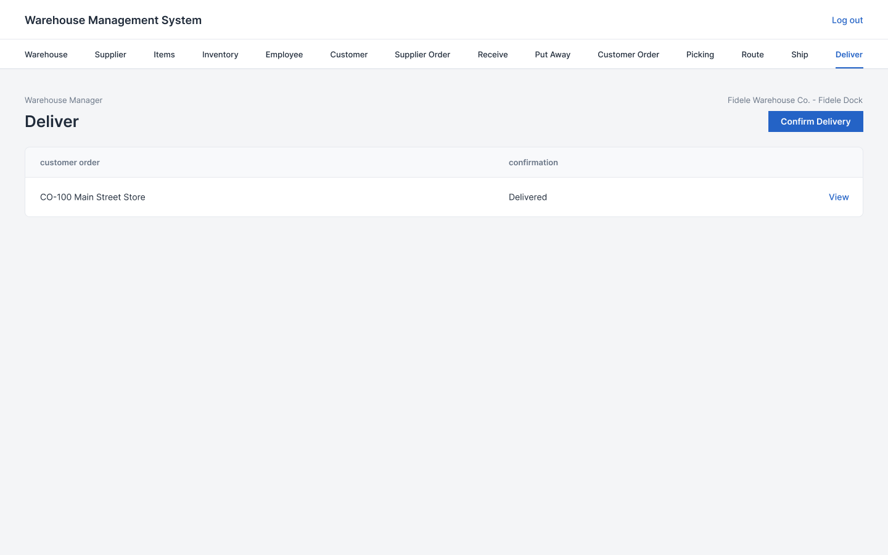
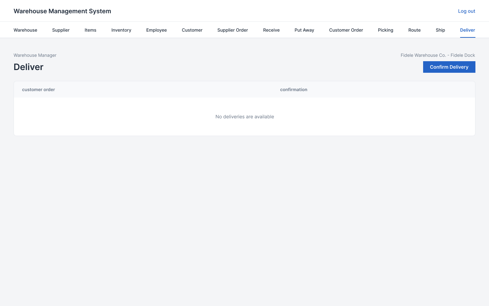
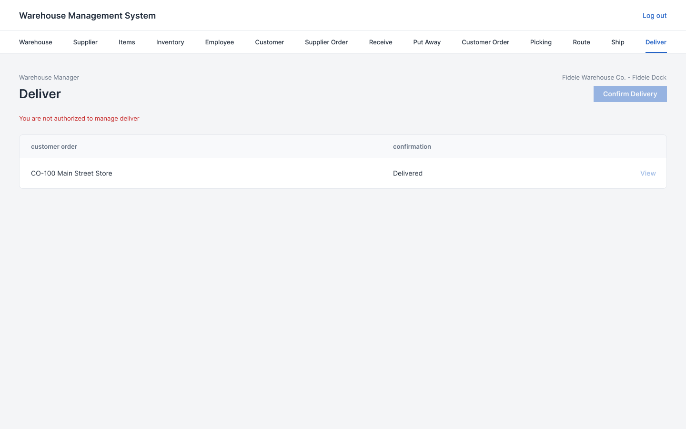
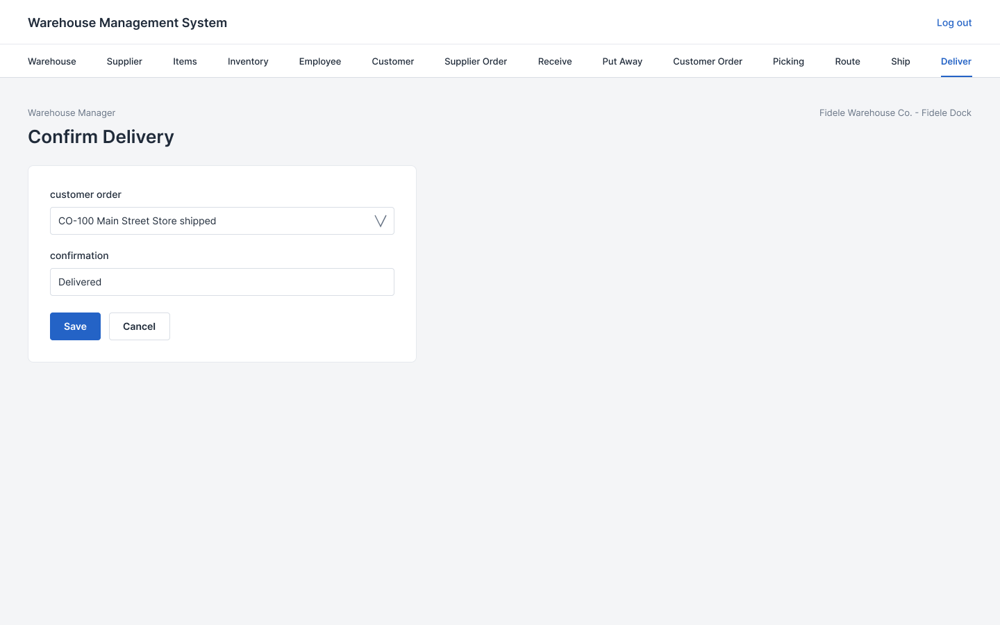
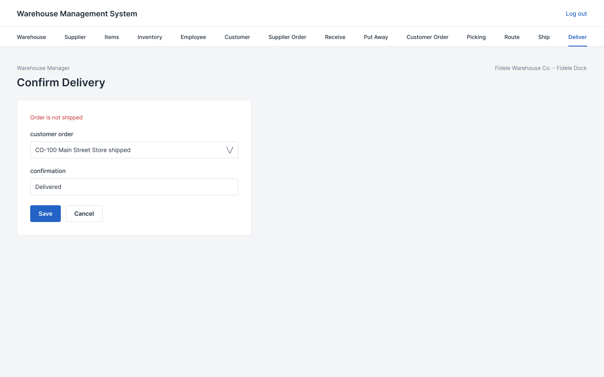
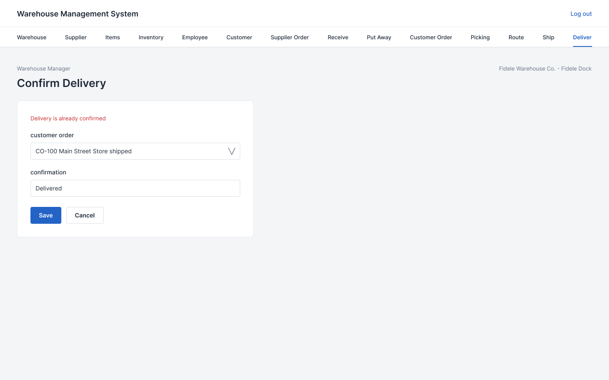
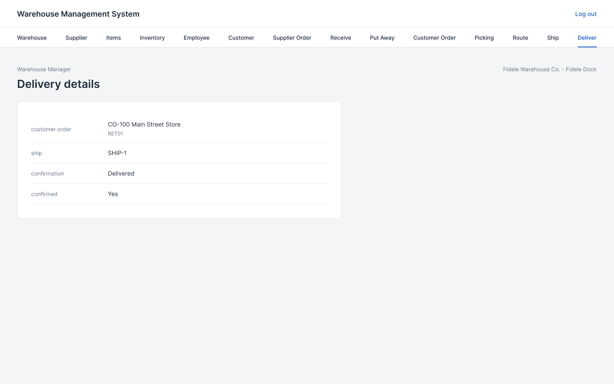

# Feature: Deliver Customer Order

**Feature ID:**        N15  
**Branch pattern:**    `feature/15-deliver-customer-order`  
**Status:**            Draft  
**Created:**           2026-19-10  
**Input:**             Delivering a shipped customer order and recording the check / confirmation.
**Build order:**        16 of 20  
**Depends on:**        [Ship Customer Order](feature_14_ship_customer_order.md), [Route](feature_10_route_maintenence.md)  
**Related:**           [Out of Stock](feature_16_out_of_stock.md) (next reports)
---

## User Stories

### US-N.15.1: View orders to deliver
**As a**        Warehouse Manager
**I want to**   View customer orders that are shipped and ready to deliver
**So that**     I can see what still needs a delivery check.
**Priority:**               P1  
**Independent test:**    Ship a customer order and select View Deliver. The order is displayed.
**Acceptance scenarios:**   US-15.1: under the acceptance criteria

### US-N.15.2: Confirm delivery
**As a**       Warehouse Manager
**I want to**  check and confirm a delivery
**So that**    the system records that the retailer store received the order.

**Priority:**               P1  
**Independent test:**    Confirm delivery for a shipped order. The delivery confirmation is saved.
**Acceptance scenarios:**   US-15.2: under the acceptance criteria

### US-N.15.3: View delivery confirmations
**As a**       Warehouse Manager
**I want to**  View delivery confirmations
**So that**    I can see which shipped orders were delivered.

**Priority:**               P1  
**Independent test:**   Confirm a delivery and select View Deliver records. The customer order and confirmation are displayed.
**Acceptance scenarios:**   US-15.3: under the acceptance criteria

---

## Functional Requirements

- **FR-001**: System Must allow the warehouse Manager to view shipped customer orders that are ready to deliver.
- **FR-002**: System Must allow an authorised Warehouse Manager to confirm delivery of a shipped customer order.
- **FR-003**: System Must record the check / confirmation for the delivery.
- **FR-004**: System Must associate each delivery confirmation with a customer order and a ship.
- **FR-005**: System Must reject a delivery confirmation when the customer order is not shipped.
- **FR-006**: System Must reject a delivery confirmation when the delivery is already confirmed.
- **FR-007**: System Must allow an authorised Warehouse Manager to view delivery confirmations.
- **FR-008**: System Must prevent unauthorized users from confirming a delivery.

---

## Key Entities

- **Delivery Confirmation**: the check that the customer received the shipped order.
- **Ship**: the ship record the delivery is confirming.
- **Customer Order**: the order that was shipped and delivered.
- **Route**: a delivery can be on a route. Route plans the trip. This feature records the confirmation.
- **Customer**: the retailer store that received the order. The retailer does not log in.

- **relationships**
- one **Customer Order** has one **Delivery Confirmation**
- one **Ship** has one **Delivery Confirmation**

---

## Data Model Requirements

### `Delivery Confirmation` table

 Field             
-------            
 `delivery_id`          : this is the unique id
 `delivery_code`        : this is the unique code for the delivery
 `customer_order_code`  : this is the customer order that was delivered
 `ship_code`            : this is the ship that is being confirmed
 `confirmed`            : this is yes when the delivery check is done
 `created_at`           : this is the time when the confirmation was saved

---

## Acceptance Criteria

### US-N.15.1 — View orders to deliver

#### Scenario: View orders ready to deliver
*   **Given** a customer order is shipped
*   **And**   the delivery is not confirmed yet
*   **When**  the warehouse Manager selects View Deliver
*   **Then**  the system displays the customer orders that are ready to deliver

#### Scenario: No orders to deliver
*   **Given** there are no shipped orders waiting for confirmation
*   **When**  the warehouse Manager selects View Deliver
*   **Then**  the system displays "No orders are available to deliver"

### US-N.15.2 — Confirm delivery

#### Scenario: Confirm a shipped order
*   **Given** the Warehouse Manager is authorized
*   **And**   a customer order is shipped
*   **When**  the manager checks and confirms the delivery
*   **Then**  the system saves the delivery confirmation
*   **And**   associates it with the customer order and the ship

#### Scenario: Order is not shipped
*   **Given** a customer order is not shipped
*   **When**  the Warehouse Manager tries to confirm delivery
*   **Then**  the delivery is not confirmed
*   **And**   the system displays "Order is not shipped"

#### Scenario: Delivery already confirmed
*   **Given** a customer order delivery is already confirmed
*   **When**  the Warehouse Manager tries to confirm it again
*   **Then**  the delivery is not confirmed
*   **And**   the system displays "Delivery is already confirmed"

### US-N.15.3 — View delivery confirmations

#### Scenario: View existing confirmations
*   **Given** delivery confirmations exist in the system
*   **When**  the warehouse Manager selects View Deliver records
*   **Then**  the system displays the confirmations
*   **And**   displays the customer order and the confirmation

#### Scenario: No delivery records
*   **Given** no delivery confirmations exist
*   **When**  the warehouse Manager selects View Deliver records
*   **Then**  the system displays "No deliveries are available"

#### Scenario: Unauthorized update
*   **Given** the user is not authorized to manage deliver
*   **When**  the user attempts to confirm a delivery
*   **Then**  the delivery is not confirmed
*   **And**   the system displays "You are not authorized to manage deliver"

---

## Assumptions

- The user is logged in as Warehouse Manager.
- Deliver confirms that a shipped customer order arrived.

---

## Edge Cases

- No delivery confirmations
- User is not authorized

---

## Success Criteria

- **SC-001**: Warehouse Manager can confirm a delivery for a customer order.
- **SC-002**: Empty list shows "No deliveries are available".
- **SC-003**: Unauthorized user sees "You are not authorized to manage deliver".

---

## Data Ownership & Isolation

Delivery confirmations belong to the warehouse. The retailer does not confirm from a store login.

| Rule | Requirement |
|------|-------------|
| **Read scope** | Warehouse Manager can view delivery confirmations |
| **Write scope** | Warehouse Manager can confirm a delivery |
| **Create scope** | New confirmation is created by the signed-in Warehouse Manager |
| **Cross-user access** | Missing record → `404`. Forbidden → "You are not authorized to manage deliver" |
| **UI scope** | Deliver menu after login |
| **Implementation** | Auth on `/api/deliveries` |

---

## API Requirements

Base path: `/api`. Errors: `{ "message": "..." }`. Auth: `Authorization: Bearer <token>`.

| Method | Endpoint | Auth | Purpose |
|--------|----------|------|---------|
| `GET` | `/api/deliveries` | Yes | List delivery confirmations |
| `GET` | `/api/deliveries/:id` | Yes | View one confirmation |
| `POST` | `/api/deliveries` | Yes | Confirm a delivery |

**Create body:** `{ "customer_order_id": 1, "confirmation": "Delivered" }`  
**Empty list:** `{ "message": "No deliveries are available" }`  
**Unauthorized:** `401` `{ "message": "You are not authorized to manage deliver" }`

---

## Screen Requirements

Menu after login: **Deliver**. Warehouse Manager. Confirm a shipped store order. Retailer does not log in.

Pictures: [`docs/ui/feature-15/`](../ui/feature-15/)

### Deliver list
- Heading: Deliver
- Button: **Confirm Delivery**
- List: customer order, confirmation

Empty: "No deliveries are available"

Not allowed: "You are not authorized to manage deliver"

### Confirm Delivery
- Fields: customer order, confirmation
- Buttons: **Save**, **Cancel**

Order not shipped: "Order is not shipped"

Already confirmed: "Delivery is already confirmed"

### Delivery details
- Shows customer order and confirmation

---

## Definition of Done

- [ ] Confirm and view deliveries match the Gherkin
- [ ] Retailer has no delivery screen of their own

---

## Out of Scope

- A retailer tapping delivered in a store app
- Coding the app (that is later)

