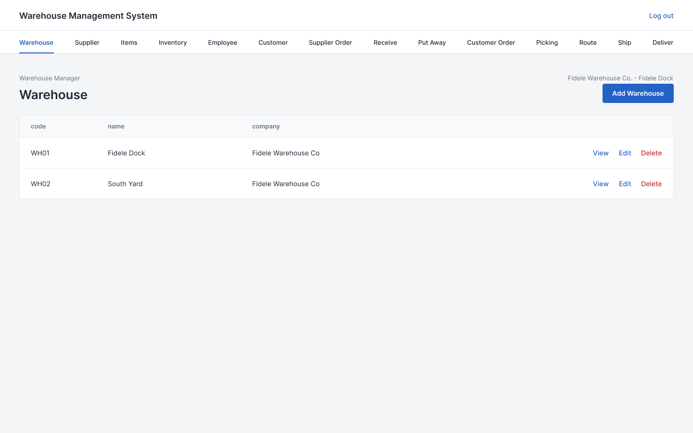
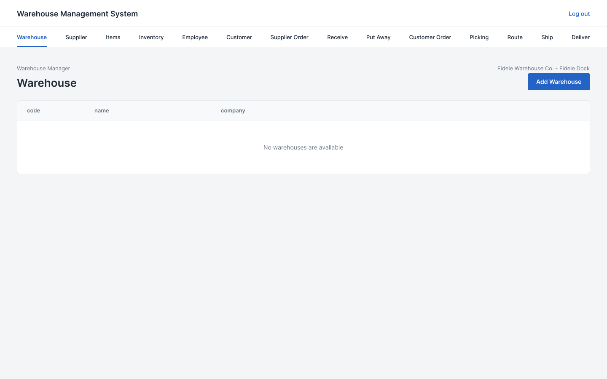
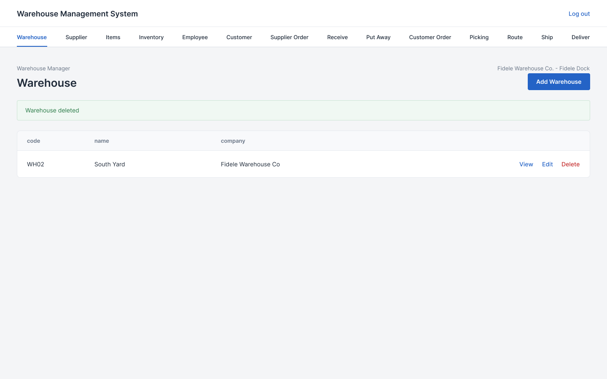
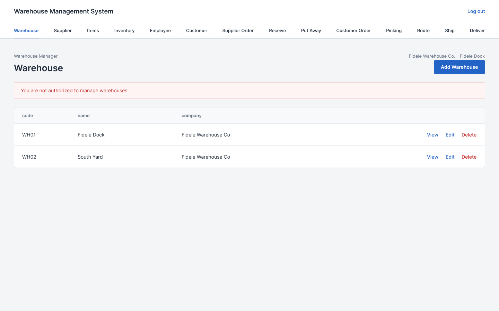
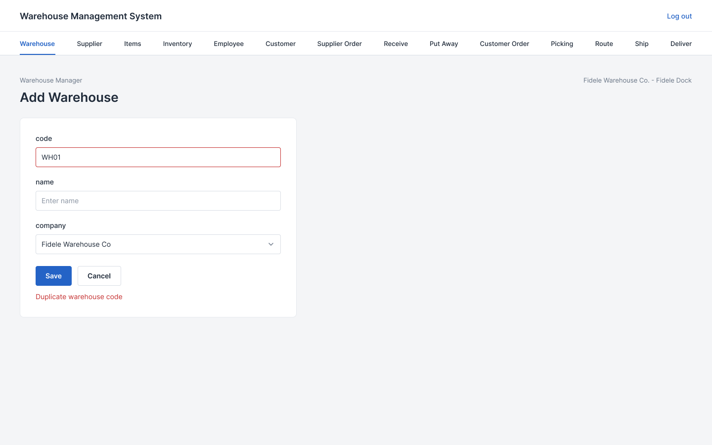
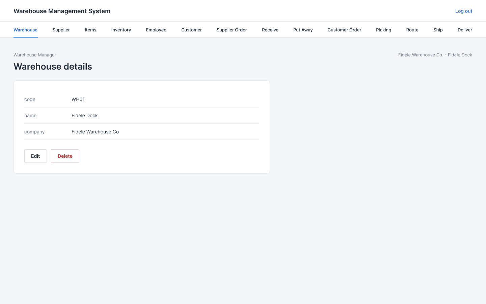
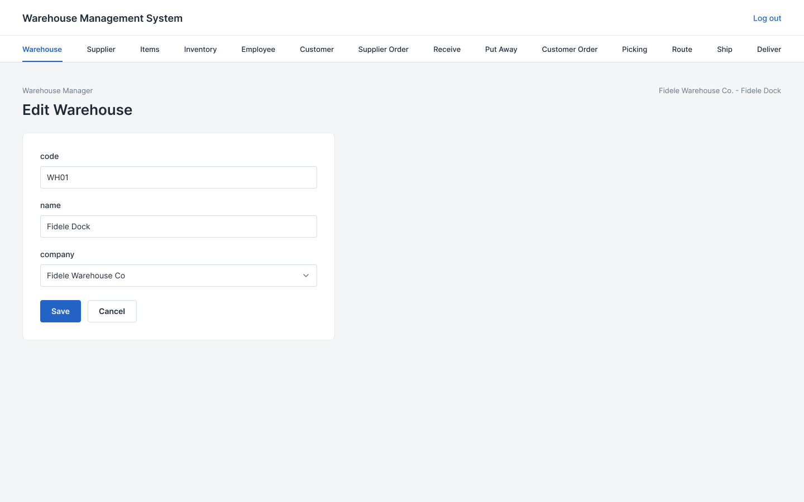

# Feature: Warehouse

**Feature ID:**        N02  
**Branch pattern:**    `feature/2-warehouse`  
**Status:**            Draft  
**Created:**           2026-09-21  
**Input:**             Creating, Viewing, editing and maintaining warehouse locations  
**Build order:**        3 of 20  
**Depends on:**        [Authentication](feature_20_authentication.md), [Company](feature_01_Company_maintinence.md)  
**Related:**           [Employee](feature_06_Employee__maintinence.md) (next), [Items](feature_04_Items__maintinence.md), [Inventory](feature_05_Inventory__maintinence.md)

---

## User Stories

### US-N02.1: View Warehouses
**As a**        A warehouse Manager  
**I want to**   View all warehouses  
**So that**     I can see the Warehouse locations maintained by the company.  
**Priority:**               P1  
**Independent test:**    Select View Warehouses and verify that the system displays all existing warehouses and their information.  
**Acceptance scenarios:**   See AC-N02.1

### US-N02.2: Add Warehouse
**As a**       Warehouse Manager  
**I want to**  add a warehouse  
**So that**    The company can maintain inventory at that location  
**Priority:**               P1  
**Independent test:**    Enter valid warehouse information and save it. Verify that the new warehouse appears in the warehouse list  
**Acceptance scenarios:**   See AC-N02.2

### US-N02.3: edit Warehouse
**As a**       Warehouse Manager  
**I want to**  Edit warehouse information  
**So that**    Warehouse information remains accurate  
**Priority:**               P1  
**Independent test:**   Change an existing warehouse address and identify that the updated address is saved and displayed  
**Acceptance scenarios:**   See AC-N02.3

### US-N02.4: Delete warehouse
**As a**       Warehouse Manager  
**I want to**  Delete a warehouse  
**So that**   Warehouses that are no longer being disappear from the company  
**Priority:**               P1  
**Independent test:** Create a warehouse with WH001 and Delete it, view warehouse and see , it will no longer exist.  
**Acceptance scenarios:**   See AC-N02.4

---

## Functional Requirements

- **FR-001**: System Must allow the warehouse Manager to view the warehouses that the company has
- **FR-002**: System Must allow an authorised warehouse manager to create a warehouse with the unique Code.
- **FR-003**: System must allow an authorised Warehouse Manager to edit the information of an existing Warehouse when needed
- **FR-004**: System MUST allow an authorized Warehouse Manager to delete the warehouse when no longer works.
- **FR-005**: System Must prevent unauthorized users from adding, editing, or deleting a warehouse.

---

## Key Entities

- **Warehouse**: Represents a physical location where inventory is stored.
- **Company**:   The company Associated with the warehouse

- **relationships** Stock maintained at a warehouse.
- one **Company** can have multiple **Warehouses**
- one **Warehouse** can contain Multiple **Items**

---

## Data Model Requirements

### `Warehouse` table

 `warehouse_id`     : This is the unique id  
 `warehouse_name`   : This is the name of the Warehouse  
 `warehouse_code`   : This is the code that is unique  
 `address`          : This is the Physical location  
 `created_at`       : This is the time when the warehouse was created

---

## Acceptance Criteria

### AC-N02.1 — View Warehouses

#### Scenario: View existing Warehouses
*   **Given** warehouse exists in the system
*   **When**  the warehouse Manager selects View Warehouses
*   **Then**  The system displays the warehouses
*   **And**   Displays their current information

#### Scenario: No warehouse
*   **Given** No warehouse exists
*   **When**  the warehouse Manager selects View Warehouses
*   **Then**  the warehouse list is empty
*   **And**   the system displays "No warehouses are available"

### AC-N02.2 — Add warehouse

#### Scenario: Add warehouse
*   **Given** The Warehouse Manager is authorized
*   **When**  The manager enters valid warehouse information
*   **Then**  the system saves the warehouse
*   **And**   associates it with the company
*   **And**   the new warehouse appears in the warehouse list

#### Scenario: Duplicate Warehouse code
*   **Given** a warehouse with a given code already exists
*   **When**  the manager tries to create another warehouse with the same code
*   **Then**  the new warehouse is not saved
*   **And**   the system displays "Duplicate warehouse code"

### AC-N02.3 — Edit Warehouse

#### Scenario: Edit warehouse
*   **Given**  A warehouse exists
*   **When**  The Warehouse manager edits its information
*   **Then**  the system saves the updated information
*   **And**   displays the updated warehouse

### AC-N02.4 — Delete warehouse

#### Scenario: Delete warehouse
*   **Given**  an active warehouse exists and No longer works
*   **When**   The warehouse manager deletes it
*   **Then**   the warehouse disappears from the lists
*   **And**    the system displays "Warehouse deleted"

#### Scenario: Unauthorized update
*   **Given**  The user is not authorized to manage warehouses
*   **When**   the user attempts to add, edit, or archive a warehouse
*   **Then**   the warehouse is not changed
*   **And**    the system displays "You are not authorized to manage warehouses"

---

## Assumptions

- The user is logged in as Warehouse Manager.
- A warehouse belongs to a company.
- Delete is allowed when that warehouse no longer works.

---

## Edge Cases

- Duplicate warehouse code
- User is not authorized
- List is empty

---

## Success Criteria

- **SC-001**: Warehouse Manager can add, view, edit, and delete a warehouse.
- **SC-002**: Unauthorized user sees "You are not authorized to manage warehouses".

---

## Data Ownership & Isolation

Warehouse records belong to the company. Only a logged in Warehouse Manager can change them.

| Rule | Requirement |
|------|-------------|
| **Read scope** | Warehouse Manager can view warehouses for the company |
| **Write scope** | Warehouse Manager can add, edit, delete |
| **Create scope** | New warehouse is created by the signed-in Warehouse Manager |
| **Cross-user access** | Missing warehouse → `404`. Forbidden → "You are not authorized to manage warehouses" |
| **UI scope** | Warehouse menu after login |
| **Implementation** | Auth on `/api/warehouses` |

---

## API Requirements

Base path: `/api`. Errors: `{ "message": "..." }`. Auth: `Authorization: Bearer <token>`.

| Method | Endpoint | Auth | Purpose |
|--------|----------|------|---------|
| `GET` | `/api/warehouses` | Yes | List warehouses |
| `GET` | `/api/warehouses/:id` | Yes | View one warehouse |
| `POST` | `/api/warehouses` | Yes | Add a warehouse |
| `PUT` | `/api/warehouses/:id` | Yes | Edit a warehouse |
| `DELETE` | `/api/warehouses/:id` | Yes | Delete a warehouse |

**Create body:** `{ "warehouse_code": "WH01", "warehouse_name": "Fidele Dock", "company_id": 1 }`  
**Delete success:** `{ "message": "Warehouse deleted" }`  
**Unauthorized:** `401` `{ "message": "You are not authorized to manage warehouses" }`

---

## Screen Requirements

Menu after login: **Warehouse**. Warehouse Manager. No Company menu on this role.

Pictures: [`docs/ui/feature-02/`](../docs/ui/feature-02/)

### Warehouse list
- Heading: Warehouse
- Button: **Add Warehouse**
- List: code, name, company
- On a row: View, Edit, Delete

Empty: "No warehouses are available"

After delete: "Warehouse deleted"

Not allowed: "You are not authorized to manage warehouses"

### Add Warehouse
- Fields: code, name, company
- Buttons: **Save**, **Cancel**

Duplicate code: "Duplicate warehouse code"

### Warehouse details
- Shows warehouse information
- Buttons: **Edit**, **Delete**

### Edit Warehouse
- Same fields as Add
- Buttons: **Save**, **Cancel**

---

## Definition of Done

- [ ] Add, view, edit, and delete match the Gherkin
- [ ] Unauthorized user cannot change a warehouse

---

## Out of Scope

- A retailer logging in to pick a warehouse
- Coding the app (that is later)

