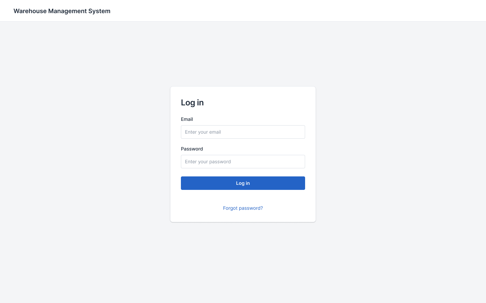
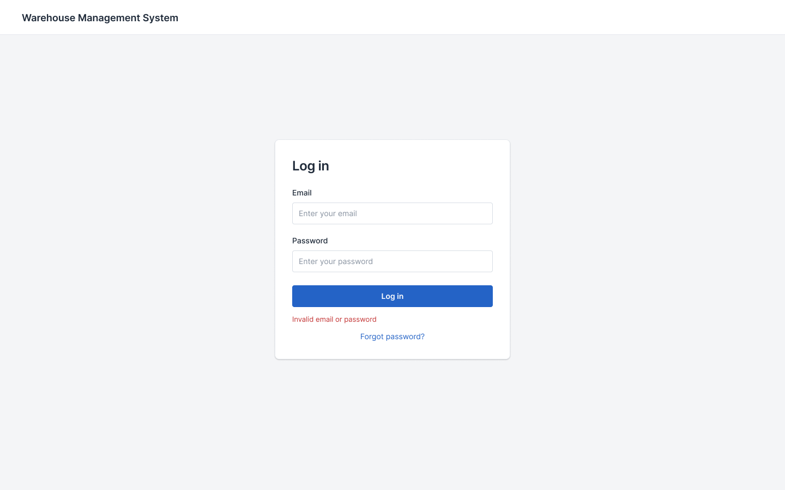
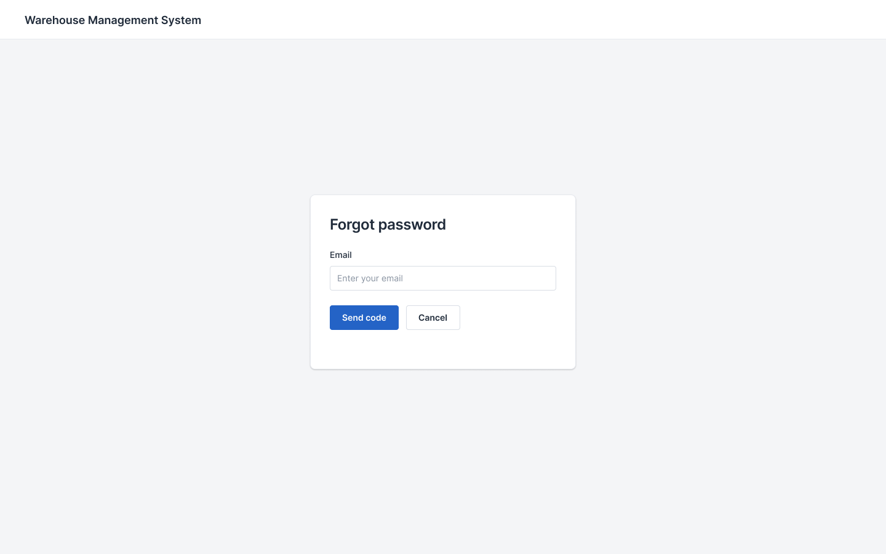
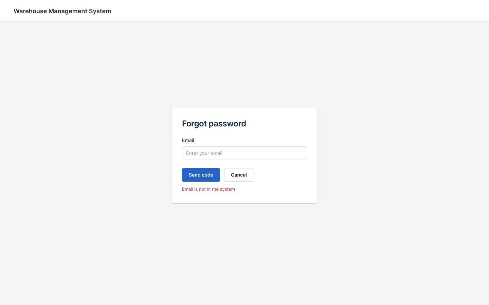
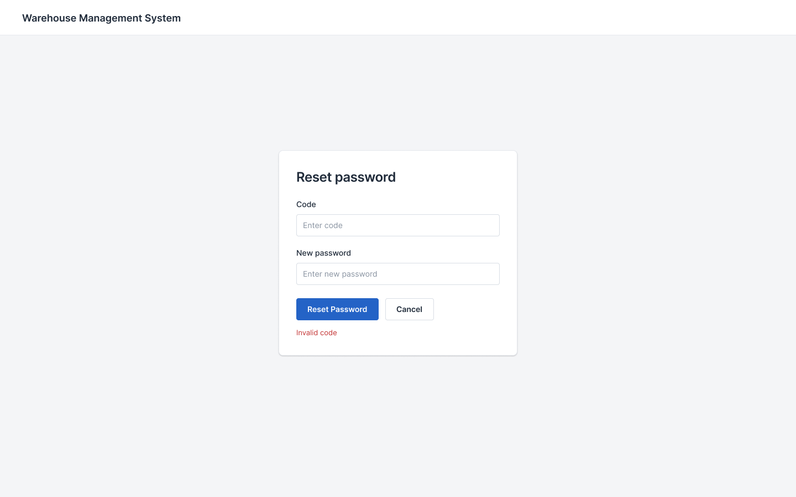
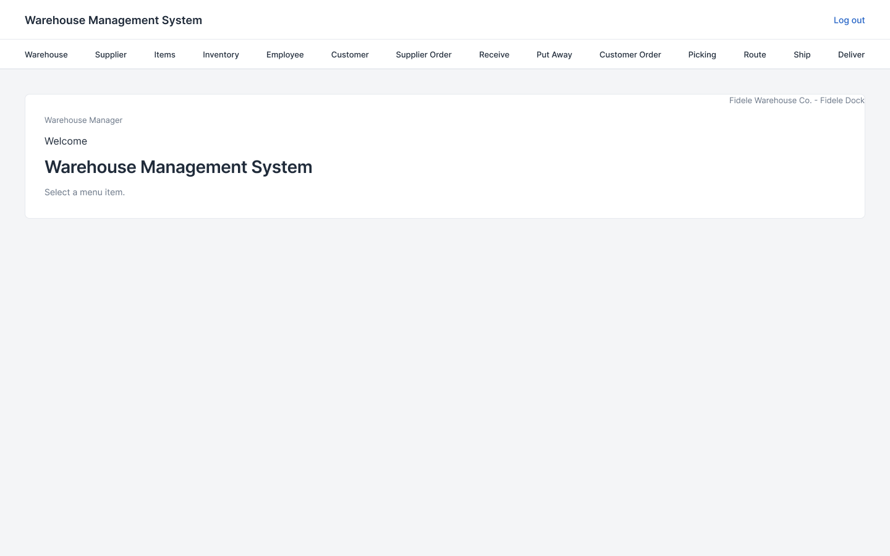
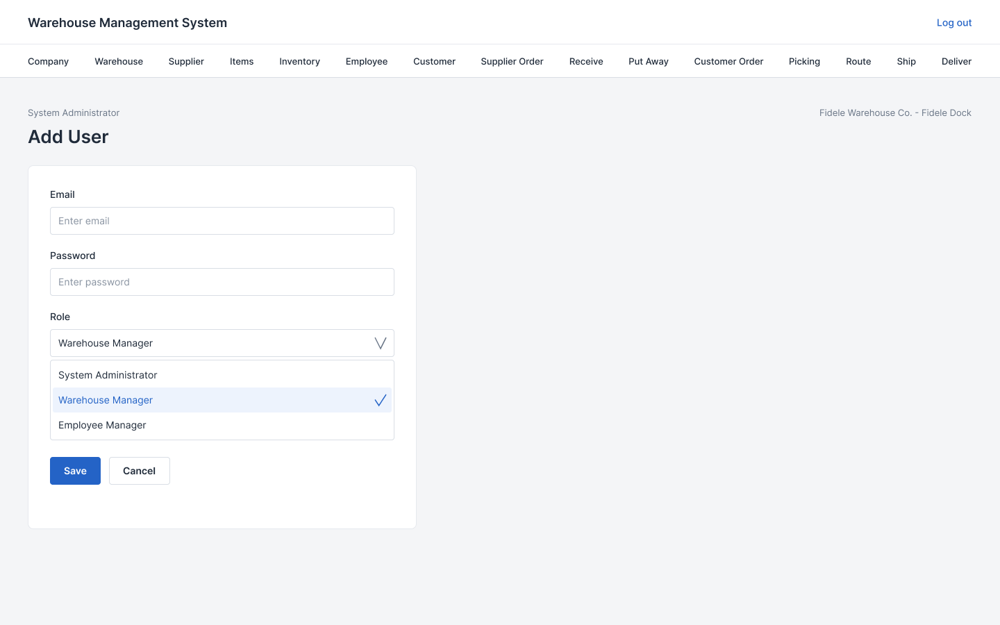
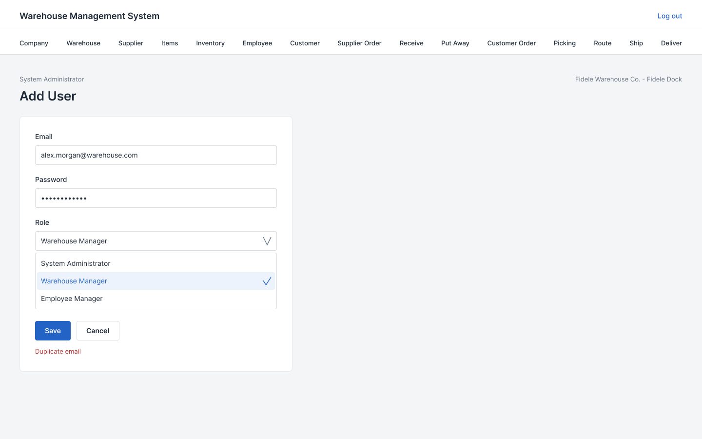

# Feature: Authentication

**Feature ID:**        N20  
**Branch pattern:**    `feature/20-authentication`  
**Status:**            Draft  
**Created:**           2026-10-29  
**Input:**             Logging in with email and password, forgot password, logging out, and adding users who can use the warehouse system  
**Build order:**        1 of 20 (first)  
**Depends on:**        None  
**Related:**           [Company](feature_01_Company_maintinence.md) (next)

---

## User Stories

### US-N20.1: Log in
**As a**        System Administrator, Warehouse Manager, or Employee Manager  
**I want to**   Log in with my email and password  
**So that**     I can use the warehouse system as my role.  
**Priority:**               P1  
**Independent test:**    Enter a saved email and password and verify that the user gets into the system with that role.  
**Acceptance scenarios:**   See AC-N20.1

### US-N20.2: Log out
**As a**        A logged in user  
**I want to**   Log out  
**So that**     the next person on the computer is not still in my account.  
**Priority:**               P1  
**Independent test:**    Log in then select Log out and verify that the login screen is displayed.  
**Acceptance scenarios:**   See AC-N20.2

### US-N20.3: Add a user
**As a**        System Administrator  
**I want to**   Add a System Administrator, Warehouse Manager, or Employee Manager  
**So that**     those people can log in as their role.  
**Priority:**               P1  
**Independent test:**    Add a Warehouse Manager with a unique email and password. Verify that the manager can log in. Add the same email again and verify the system displays "Duplicate email".  
**Acceptance scenarios:**   See AC-N20.3

### US-N20.5: Forgot password
**As a**        A user who cannot log in  
**I want to**   Get a code in my email and set a new password  
**So that**     I can log in again.  
**Priority:**               P2  
**Independent test:**    Select Forgot password, enter a saved email, receive a code, enter the code and a new password, then log in with that password.  
**Acceptance scenarios:**   See AC-N20.5

### US-N20.4: Block users who are not logged in
**As a**        The warehouse system  
**I want to**   Keep company and warehouse screens closed until a user logs in  
**So that**     a person who is not logged in cannot change company or warehouse information.  
**Priority:**               P1  
**Independent test:**    Open a warehouse screen without logging in. The login screen is displayed and no warehouse record is changed.  
**Acceptance scenarios:**   See AC-N20.4

---

## Functional Requirements

- **FR-001**: System Must allow a System Administrator, Warehouse Manager, or Employee Manager to log in with email and password.
- **FR-002**: System Must log the user in when the email and password match a saved user.
- **FR-003**: System Must prevent login when the email or password is wrong and display "Invalid email or password".
- **FR-004**: System Must keep the user role after login (System Administrator, Warehouse Manager, or Employee Manager).
- **FR-005**: System Must allow a logged in user to log out.
- **FR-006**: System Must allow an authorised System Administrator to add a user with a unique email, password, and role.
- **FR-007**: System Must prevent adding a user when that email already exists and display "Duplicate email".
- **FR-008**: System Must associate each user with an employee when the user is an employee of the company.
- **FR-009**: System Must prevent a person who is not logged in from viewing or changing company, warehouse, or employee information.
- **FR-010**: System Must prevent unauthorized users from adding a user.
- **FR-011**: System Must not give retailers a login. Retailers send orders outside the system. The warehouse records those orders.
- **FR-012**: System Must show Forgot password on the login screen.
- **FR-013**: System Must send a code to the user's email when the email is a saved user.
- **FR-014**: System Must display "A code was sent to your email" after the code is sent.
- **FR-015**: System Must display "Email is not in the system" when the email is not a saved user.
- **FR-016**: System Must save the new password only when the code is correct, then the user can log in with the new password.
- **FR-017**: System Must display "Invalid code" when the code is wrong.

---

## Assumptions

- Only System Administrator, Warehouse Manager, and Employee Manager can log in.
- A retailer does not log in.
- The user must be logged in before Company or Warehouse screens open.
- Forgot password sends a code to the saved email.

---

## Edge Cases

- Wrong email or wrong password.
- Forgot password email is not in the system.
- Wrong reset code.
- User is not logged in and tries to open Company.
- Duplicate email when adding a user.

---

## Success Criteria

- **SC-001**: A saved user can log in with email and password and see screens for that role.
- **SC-002**: Wrong email or password shows "Invalid email or password".
- **SC-003**: Log out shows the login screen.
- **SC-004**: Forgot password sends a code, then the new password works at login.
- **SC-005**: A person who is not logged in cannot change company or warehouse information.

---

## Key Entities

- **User**: a person who logs in. The role is System Administrator, Warehouse Manager, or Employee Manager.
- **Employee**: the company record for that person.
- **Company**: the company the user works for.

- **relationships**
- one **User** has one **Role**
- one **Employee** can have one **User** login
- one **Company** can have multiple **Users**

---

## Data Model Requirements

### `User` table

 `user_id`         : This is the unique id  
 `email`           : This is the unique email used to log in  
 `password`        : This is the password used to log in  
 `role`            : System Administrator, Warehouse Manager, or Employee Manager  
 `employee_id`     : This is the employee this login belongs to  
 `reset_code`      : This is the code sent to the email for forgot password  
 `created_at`      : This is the time when the user was created

---

## Acceptance Criteria

### AC-N20.1 — Log in

#### Scenario: User logs in
*   **Given** a user exists with email manager@warehouse.com and a password
*   **When**  the user enters that email and password
*   **Then**  the system logs the user in
*   **And**   displays the screens for that role

#### Scenario: Wrong password
*   **Given** a user exists with email manager@warehouse.com
*   **When**  the user enters manager@warehouse.com and the wrong password
*   **Then**  the user is not logged in
*   **And**   the system displays "Invalid email or password"

#### Scenario: Wrong email
*   **Given** no user has email nobody@warehouse.com
*   **When**  a user attempts to log in with nobody@warehouse.com
*   **Then**  the user is not logged in
*   **And**   the system displays "Invalid email or password"

### AC-N20.2 — Log out

#### Scenario: User logs out
*   **Given** the user is logged in
*   **When**  the user selects Log out
*   **Then**  the user is logged out
*   **And**   the login screen is displayed

### AC-N20.3 — Add a user

#### Scenario: Add a warehouse manager
*   **Given** the System Administrator is authorized
*   **When**  the System Administrator enters a unique email, a password, and role Warehouse Manager
*   **Then**  the system saves the user
*   **And**   that warehouse manager can log in

#### Scenario: Duplicate email
*   **Given** a user with email manager@warehouse.com already exists
*   **When**  the System Administrator tries to add another user with manager@warehouse.com
*   **Then**  the new user is not saved
*   **And**   the system displays "Duplicate email"

#### Scenario: Unauthorized add
*   **Given** the user is not authorized to add a user
*   **When**  the user attempts to add a user
*   **Then**  the user is not saved
*   **And**   the system displays "You are not authorized to manage users"

### AC-N20.4 — Block users who are not logged in

#### Scenario: Not logged in
*   **Given** the user is not logged in
*   **When**  the user attempts to view or change company, warehouse, or employee information
*   **Then**  the change is not saved
*   **And**   the login screen is displayed

### AC-N20.5 — Forgot password

#### Scenario: Code is sent
*   **Given** a user exists with email manager@warehouse.com
*   **And**   the user is on the Forgot password screen
*   **When**  the user enters manager@warehouse.com
*   **And**   selects Send code
*   **Then**  the system sends a code to that email
*   **And**   the system displays "A code was sent to your email"

#### Scenario: Reset password with code
*   **Given** a code was sent to manager@warehouse.com
*   **When**  the user enters that code and a new password
*   **And**   selects Reset Password
*   **Then**  the system saves the new password
*   **And**   the user can log in with that email and the new password

#### Scenario: Email is not in the system
*   **Given** no user has email nobody@warehouse.com
*   **When**  the user tries to send a code to nobody@warehouse.com
*   **Then**  no code is sent
*   **And**   the system displays "Email is not in the system"

#### Scenario: Invalid code
*   **Given** a code was sent to the user
*   **When**  the user enters the wrong code
*   **Then**  the password is not changed
*   **And**   the system displays "Invalid code"

#### Scenario: Cancel reset
*   **Given** the user is on the Forgot password screen
*   **When**  the user selects Cancel
*   **Then**  the login screen is displayed

---

## Data Ownership & Isolation

Login records belong to the warehouse. Retailers have no user row.

| Rule | Requirement |
|------|-------------|
| **Read scope** | A logged in user sees screens for that role |
| **Write scope** | Only System Administrator can add a user |
| **Create scope** | System Administrator creates the login |
| **Cross-user access** | Not logged in → login screen. Forbidden add user → "You are not authorized to manage users" |
| **UI scope** | Company and Warehouse stay closed until login |
| **Implementation** | Token on protected `/api` routes |

---

## API Requirements

Base path: `/api`. Error body: `{ "message": "..." }`.

| Method | Endpoint | Auth | Purpose |
|--------|----------|------|---------|
| `POST` | `/api/login` | No | Log in with email and password |
| `POST` | `/api/logout` | Yes | Log out |
| `POST` | `/api/forgot-password` | No | Send a code to the email |
| `POST` | `/api/reset-password` | No | Enter code and new password |
| `POST` | `/api/users` | Yes | Add a user (System Administrator) |

**Log in body:** `{ "email": "manager@warehouse.com", "password": "secret" }`  
**Wrong login:** `401` `{ "message": "Invalid email or password" }`  
**Code sent:** `{ "message": "A code was sent to your email" }`  
**Unknown email:** `400` `{ "message": "Email is not in the system" }`  
**Wrong code:** `400` `{ "message": "Invalid code" }`  
**Duplicate user:** `400` `{ "message": "Duplicate email" }`

---

## Screen Requirements

Menu before login: app name **Warehouse Management System** only. No Company. No Warehouse.

Pictures: [`docs/ui/feature-20/`](../docs/ui/feature-20/)

### Log in
- Email, Password
- Button: **Log in**
- Link: **Forgot password?**

Wrong login: "Invalid email or password"

### Forgot password — send code
- Email
- Buttons: **Send code**, **Cancel**

Message: "A code was sent to your email"

Unknown email: "Email is not in the system"

### Forgot password — new password
- Code, New password
- Buttons: **Reset Password**, **Cancel**

Wrong code: "Invalid code"

### After login
- Menu: **Company**, **Warehouse**, and the other warehouse pages
- **Log out**

### Add user (System Administrator)
- Email, password, role
- Buttons: **Save**, **Cancel**

Duplicate: "Duplicate email"

---

## Definition of Done

- [ ] Login, logout, forgot password, and add user match the Gherkin messages
- [ ] Company and Warehouse are closed until login
- [ ] Retailer has no login screen

---

## Out of Scope

- A retailer logging into the warehouse system
- Google or Facebook login
- Coding the app (that is later)

