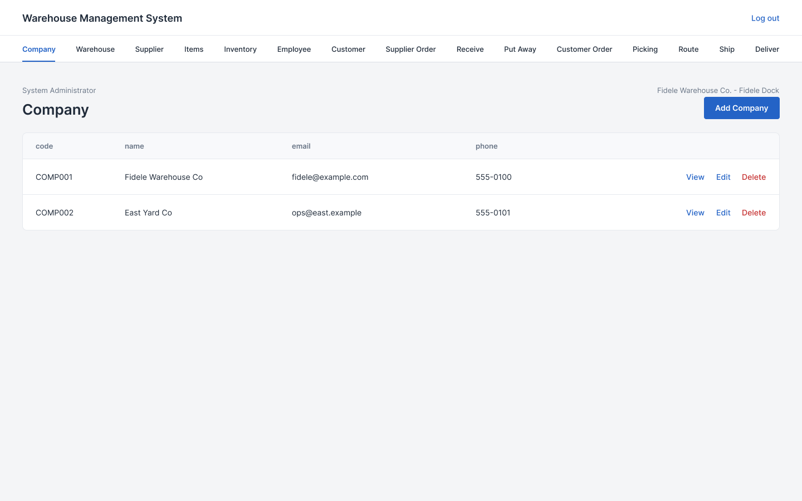
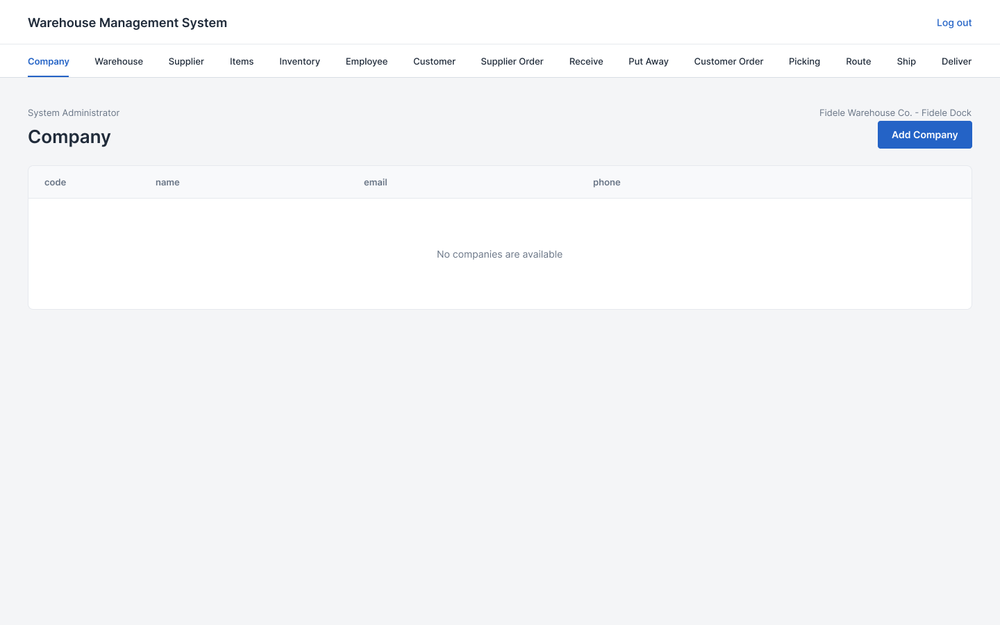
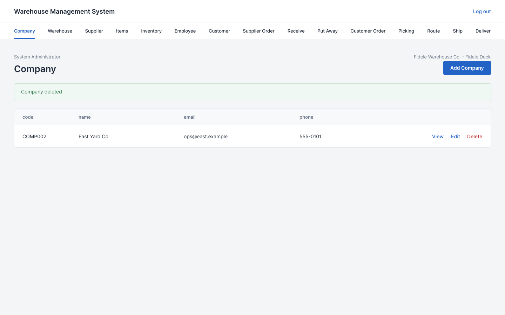
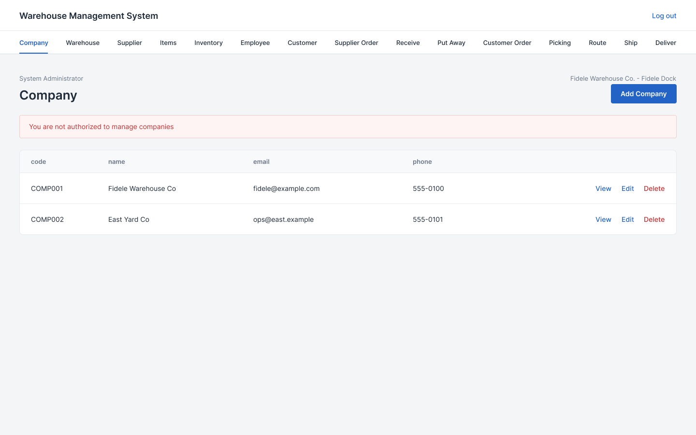
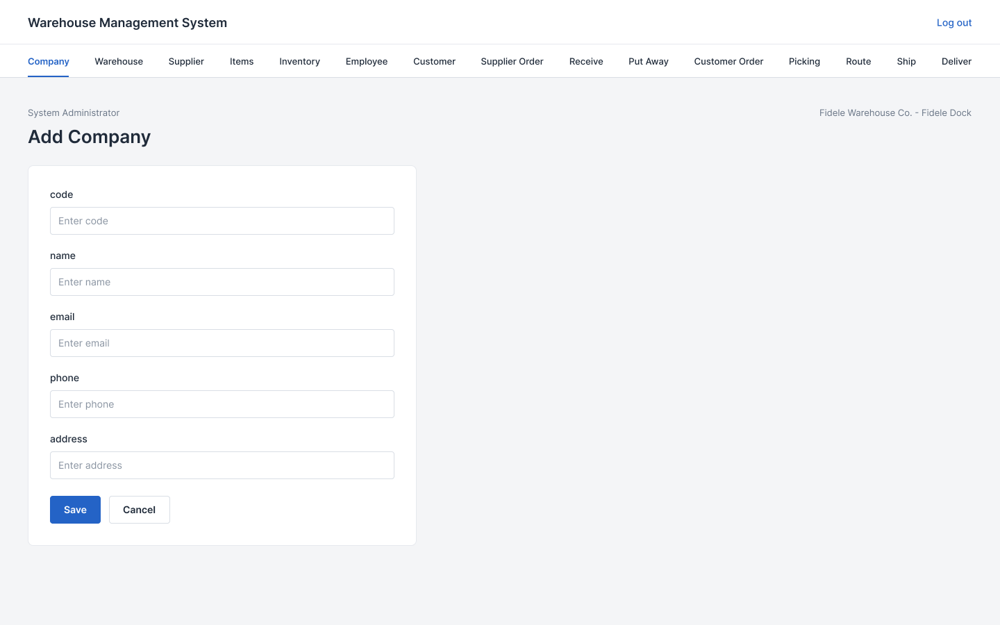
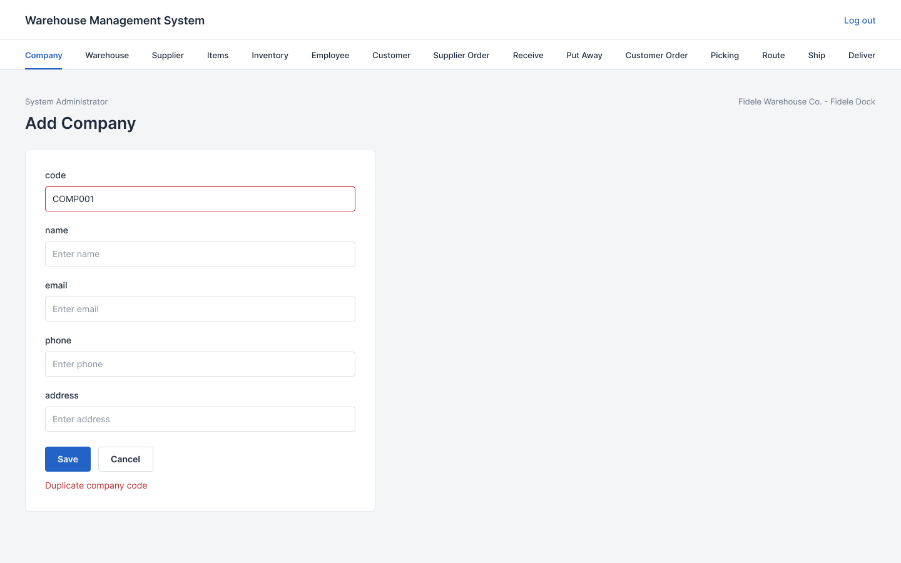
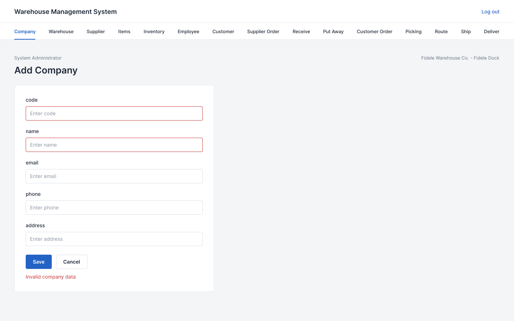
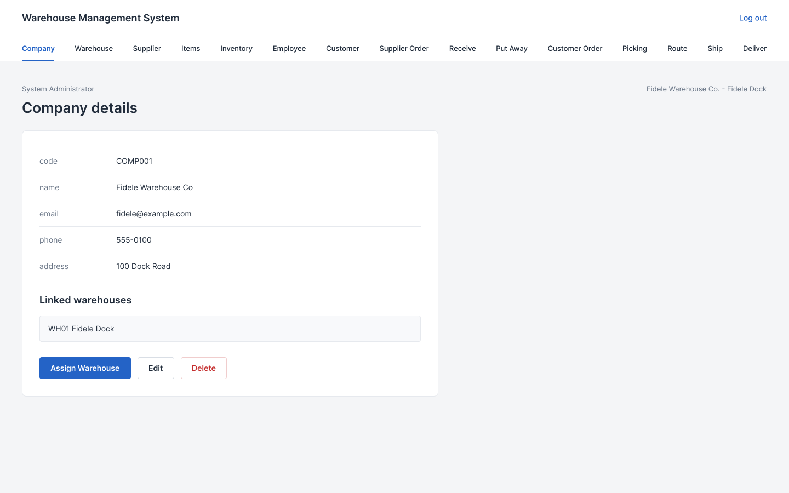
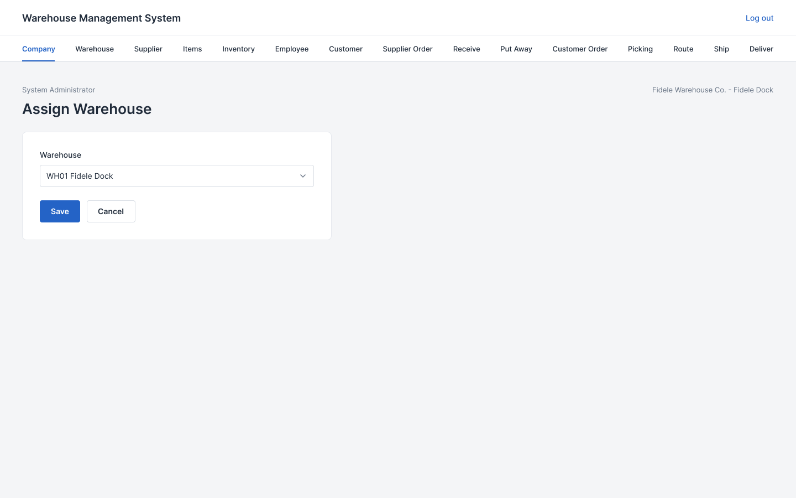
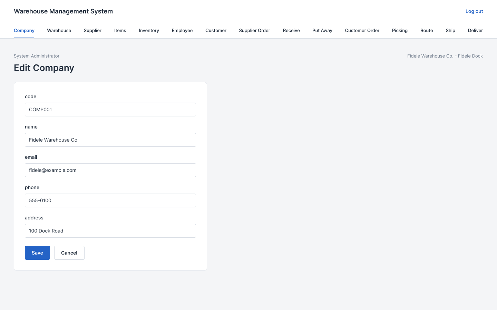

# Feature: Company

**Feature ID:**        N01  
**Branch pattern:**    `feature/1-company`  
**Status:**            Draft  
**Created:**           2026-09-21  
**Input:**             Company registration, company information management, and company status management.  
**Depends on:**        [Authentication](feature_20_authentication.md)  
**Related:**           [Warehouse](feature_02_Warehouse__maintinence.md)

---

## User Stories

### US-N01.1: Creating company
**As a**        System Administrator  
**I want to**   Create a company information  
**So that**     the System maintains accurate information about the company using the warehouse system.  
**Priority:**               P1  
**Independent test:**    Create a company with a unique code and valid company information  
**Acceptance scenarios:**   See AC-N01.1

### US-N01.2: View Company Information
**As a**      System Administrator  
**I want to** View company details  
**So that**   I can access company information when needed.  
**Priority:**               P1  
**Independent test:**  Search for an existing company and verify its information is displayed.  
**Acceptance scenarios:**   See AC-N01.2

### US-N01.3: Edit Company Information
**As a**      System Administrator  
**I want to** Update Company information  
**So that**   company records remain accurate and updated  
**Priority:**               P1  
**Independent test:** Update company information and verify the changes are saved and can be displayed.  
**Acceptance scenarios:**   See AC-N01.3

### US-N01.4: Assigning a warehouse to a company
**As a**      System Administrator  
**I want to** assign the warehouse to a company  
**So that**   the warehouse belongs to the Company.  
**Priority:**               P1  
**Independent test:** When a company is given a warehouse, it belongs to it in the documentation.  
**Acceptance scenarios:**   See AC-N01.4

### US-N01.5: Delete a Company
**As a**      System Administrator  
**I want to** Delete a company  
**So that**   The company's status should correspond to the actual status of the Company.  
**Priority:**               P1  
**Independent test:** When a company stops permanently, its information should not exist.  
**Acceptance scenarios:**   See AC-N01.5

---

## Functional Requirements

- **FR-001**: System MUST assign each company a unique identifier.
- **FR-002**: System Must allow the authorised user to view the Company that exists.
- **FR-003**: System MUST allow the authorized users to create company information.
- **FR-004**: System MUST allow authorized users to edit company information.
- **FR-005**: System MUST allow warehouses to be associated with a company.
- **FR-006**: System Must allow the authorized user to delete a company.
- **FR-007**: System Must prevent unauthorized users from creating, editing, assigning a warehouse, or deleting a company.

---

## Assumptions

- Only a System Administrator can manage companies.
- The user is logged in (N20) before company screens are shown.
- A company code is unique.
- One company can have more than one warehouse.
- Retailers do not log in and do not manage company records.

---

## Edge Cases

- Create with a company code that already exists.
- View companies when none exist.
- Assign a warehouse that is already linked to a company.
- Delete when the user is not a System Administrator.
- Empty name or empty company code.

---

## Success Criteria

- **SC-001**: An authorized System Administrator can create a company with a unique code and see it in the company list.
- **SC-002**: Duplicate company code is rejected and the system displays "Duplicate company code".
- **SC-003**: An authorized user can view company information and linked warehouses.
- **SC-004**: An authorized user can edit company information and see the saved values.
- **SC-005**: An unauthorized user cannot create, edit, or delete a company and the system displays "You are not authorized to manage companies".
- **SC-006**: When no company exists, the list is empty and the system displays "No companies are available".

---

## Key Entities

- **Company**: the business that owns the warehouses.
- **Warehouse**: a storage location that belongs to a company.

- **Relationship:** One company can have one or more warehouses.

---

## Initial Data Model

### `Company` table

 `company_id`    : this is the unique id  
 `company_code`  : unique code identification  
 `company_name`  : Unique name for the reference  
 `company_email` : Company business E-mail  
 `company_phone` : This is the business Phone for the business  
 `address`       : This is the Map address for the business Location  
 `created_at`    : This is the Date it was created

---

## Gherkin AC

### AC-N01.1 — Create Company

#### Scenario: Create Company
*   **Given**  System Administrator is authorized
*   **When**  the System Administrator enters valid company information
*   **Then**  the system creates the company
*   **And**   assigns the company a unique identifier
*   **And**   the new company appears in the company list

#### Scenario: Duplicate Company Code
*   **Given** a company with code COMP001 already exists
*   **When**  another company is created using COMP001
*   **Then**  the new company is not created
*   **And**   the system displays "Duplicate company code"

#### Scenario: Invalid company data
*   **Given** the System Administrator is authorized
*   **When**  they submit a company with an empty name or empty code
*   **Then**  the company is not created
*   **And**   the system displays "Invalid company data"

### AC-N01.2 — View a company

#### Scenario: View Company
*   **Given** a company already exists
*   **When**  the authorized user clicks view the company
*   **Then**  the system displays companies
*   **And**   displays the company information

#### Scenario: No companies
*   **Given** no company exists
*   **When**  the authorized user selects View Company
*   **Then**  the company list is empty
*   **And**   the system displays "No companies are available"

### AC-N01.3 — Edit Company Information

#### Scenario: Edit Company
*   **Given** a company already exists
*   **When**  the authorized user updates the company information
*   **Then**  the system saves the changes
*   **And**   Displays the updated company information

### AC-N01.4 — Assigning a warehouse to a company

#### Scenario: Associate Warehouse
*   **Given**  a company exists
*   **And**    a warehouse exists
*   **When**   the authorized user assigns the warehouse to the company
*   **Then**   a warehouse is linked to the company
*   **And**    The association is saved
*   **And**    the company details show the associated warehouse

#### Scenario: View Associated Warehouse
*   **Given**  a company has one or more warehouses
*   **When**   the authorized user views the company details
*   **Then**   the system displays associated warehouse

### AC-N01.5 — Delete a company

#### Scenario: Delete company
*   **Given**  The company no longer works
*   **When**   the authorized user presses DELETE
*   **Then**   the company become deleted in the System
*   **And**    the company does not appear in the company list
*   **And**    the system displays "Company deleted"

#### Scenario: Unauthorized change
*   **Given** the user is not authorized to manage companies
*   **When**  the user attempts to create, edit, or delete a company
*   **Then**  the company is not changed
*   **And**   the system displays "You are not authorized to manage companies"

---

## Data Ownership

Company records belong to the warehouse system. Only a logged-in System Administrator may create, edit, assign warehouses, or delete.

| Rule | Requirement |
|------|-------------|
| **Read scope** | Logged-in System Administrator can view companies |
| **Write scope** | Only System Administrator can create, edit, assign, or delete |
| **Create scope** | New company rows are created by the signed-in System Administrator |
| **Cross-user access** | Missing or forbidden company → `404` with `{ "message": "..." }` (not `403`) |
| **UI scope** | Company screens are shown only after login |
| **Implementation** | Auth check on `/api/companies` routes |

---

## API Requirements

API mount: `/api`. Errors: `{ "message": "..." }`. Auth: `Authorization: Bearer <token>`.

| Method | Endpoint | Auth | Purpose |
|--------|----------|------|---------|
| `GET` | `/api/companies` | Yes | List companies |
| `GET` | `/api/companies/:id` | Yes | View one company and linked warehouses |
| `POST` | `/api/companies` | Yes | Create a company |
| `PUT` | `/api/companies/:id` | Yes | Edit a company |
| `DELETE` | `/api/companies/:id` | Yes | Delete a company |
| `PUT` | `/api/companies/:id/warehouses/:warehouseId` | Yes | Assign a warehouse to the company |

**Create request body:**

```json
{
  "company_code": "COMP001",
  "company_name": "Fidele Warehouse Co",
  "company_email": "ops@north.example",
  "company_phone": "555-0100",
  "address": "100 Dock Road"
}
```

**Success create:** `201` with the saved company including `company_id`.  
**Duplicate code:** `400` `{ "message": "Duplicate company code" }`  
**Invalid data:** `400` `{ "message": "Invalid company data" }`  
**Unauthorized:** `401` `{ "message": "You are not authorized to manage companies" }`  
**Not found:** `404`

---

## Screen Requirements

Menu after login: **Company** (System Administrator only). No Company menu on the login screen.

Pictures: [`docs/ui/feature-01/`](../docs/ui/feature-01/)

### Company list
- Heading: Company
- Button: **Add Company**
- List: code, name, email, phone
- On a row: View, Edit, Delete



Empty: "No companies are available"



After delete: "Company deleted"



Not allowed: "You are not authorized to manage companies"



### Add Company
- Fields: code, name, email, phone, address
- Buttons: **Save**, **Cancel**



Duplicate code: "Duplicate company code"



Empty name or code: "Invalid company data"



### Company details
- Shows company information and linked warehouses
- Buttons: **Assign Warehouse**, **Edit**, **Delete**



### Assign Warehouse
- Choose a warehouse
- Buttons: **Save**, **Cancel**



### Edit Company
- Same fields as Add
- Buttons: **Save**, **Cancel**



---

## Definition of Done

- [ ] Stories, FRs, Gherkin, API, and screens match
- [ ] Duplicate code and unauthorized cases use the quoted messages
- [ ] Empty list shows "No companies are available"
- [ ] Tests mapped to each scenario pass (`npm test`) when this feature is implemented
- [ ] Living reference `features/reference/` updated in the implementation PR

---

## Out of Scope

- Retailer login or retailer company screens
- Multi-region or many companies in different countries
- Restoring a deleted company
- Figma visual polish beyond the fields and labels listed above
