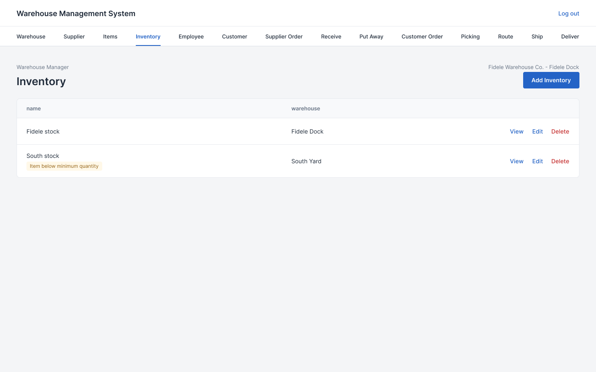
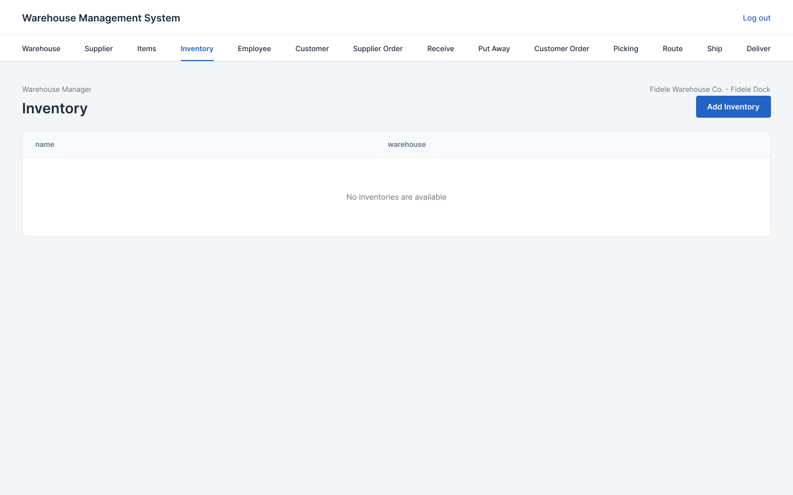
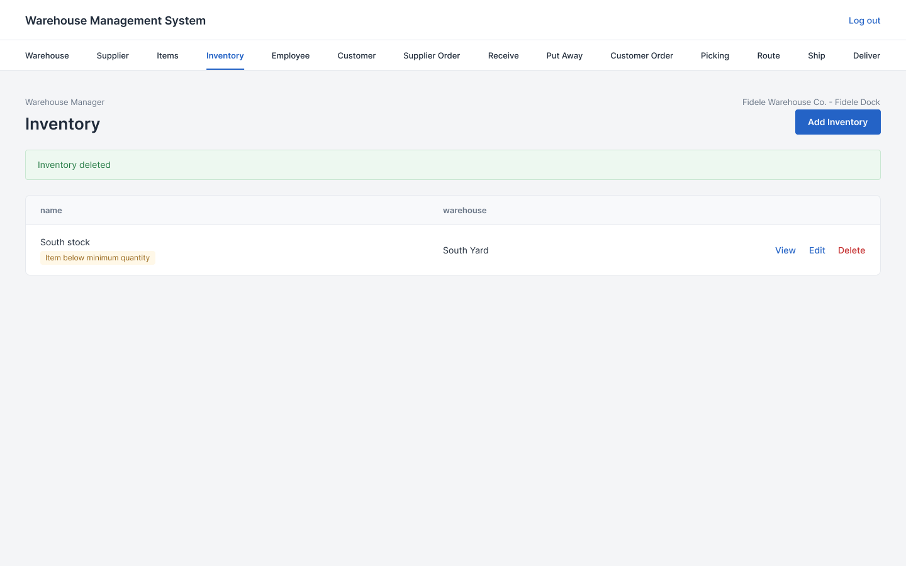
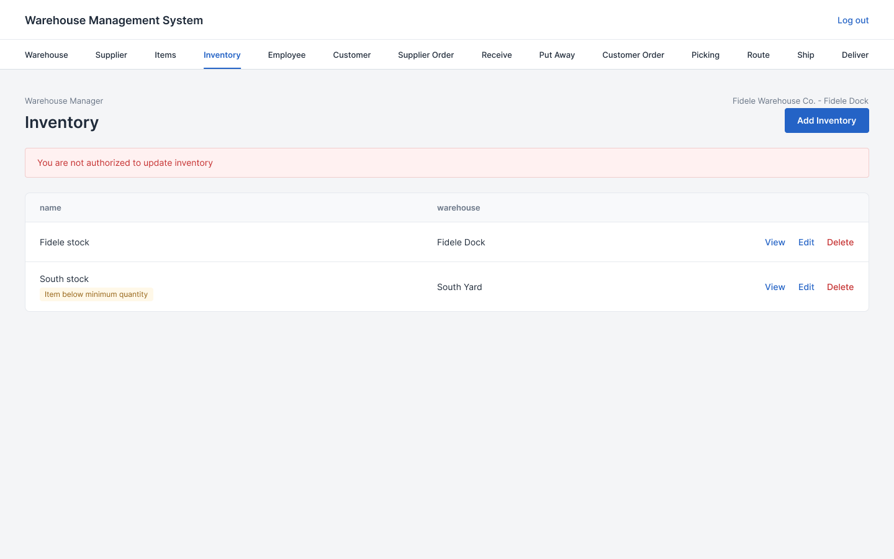
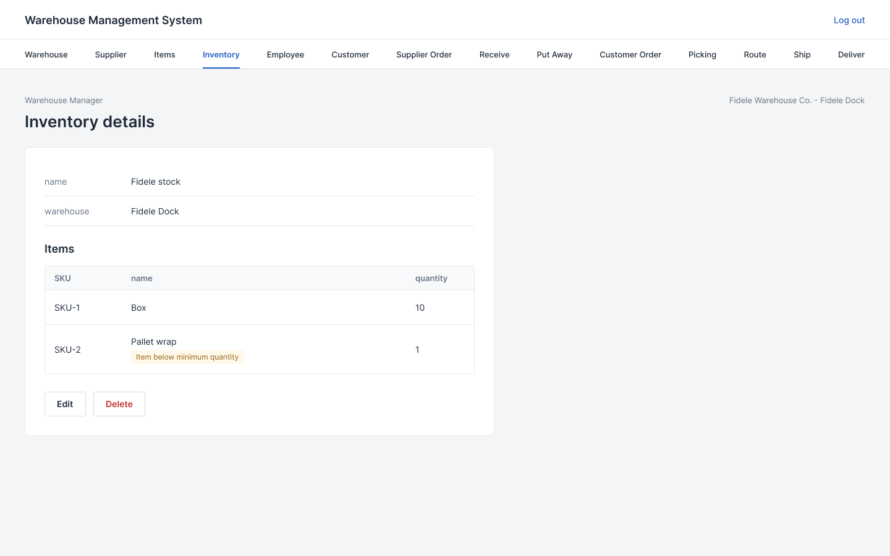
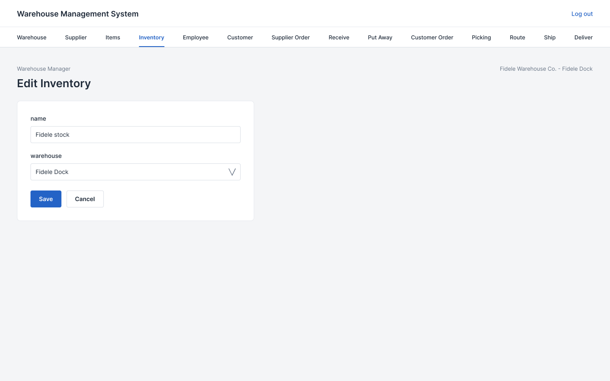

# Feature: Inventory

**Feature ID:**        N05  
**Branch pattern:**    `feature/5-inventory`  
**Status:**            Draft  
**Created:**           2026-09-21  
**Input:**             Tracking, inspecting, and maintaining the inventory.  
**Depends on:**        [Warehouse](feature_02_Warehouse__maintinence.md), [Items](feature_04_Items__maintinence.md)  
**Related:**           [Receiving](feature_11_receiving.md), [Put Away](feature_12_put_away.md), [Picking](feature_13_picking.md), [Supplier Order](feature_08_Supplier_order_Management.md), [Customer Order](feature_09_Customer_Order_Management.md), [Out of Stock](feature_16_out_of_stock.md)

---

## User Stories

### US-N05.1: View Live Stock level
**As a**       a Warehouse Manager  
**I want to**  View the current quantity of each Item in the stock  
**So that**    I know what items are available in the stock  
**Priority:**               P1  
**Independent test:**       select view the items, the system must display each item and the current quantity in the stock  
**Acceptance scenarios:**   See AC-N05.1

### US-N05.2: Add an inventory
**As a**       As a warehouse Manager  
**I want to**  To add an inventory  
**So that**    I can have the inventory information  
**Priority:**              P1  
**Independent test:**      if inventory is added it will appear on the list of the inventories  
**Acceptance scenarios:**  See AC-N05.2

### US-N05.3: Update an inventory
**As a**       As a warehouse Manager  
**I want to**  To update the inventory information  
**So that**    I can have the updated information of the inventory  
**Priority:**              P1  
**Independent test:**      if an inventory name is edited the new name appears on the list of the informations  
**Acceptance scenarios:**  See AC-N05.3

### US-N05.4: Automated warning
**As a**        Application  
**I want to**   Display the warning message  
**When**        The item is below the minimum.  
**So that**     They can order the items needed to be to the maximum level.  
**Priority:**             P1  
**Independent test:**     when the item is below the minimum , the system gives the warning message.  
**Acceptance scenarios:** See AC-N05.4

---

## Functional Requirements

- **FR-001**: System shall display the current Stock quantity of each item in a warehouse.
- **FR-002**: System MUST allow the authorised inventory manager to add an inventory
- **FR-003**: System MUST allow the authorised inventory manager to edit the inventory information
- **FR-004**: System MUST allow the authorised inventory manager to delete
- **FR-005**: the system Must give the warning to the inventory manager when given type of the item goes below the minimum quantity.
- **FR-006**: System Must prevent unauthorized users from adding, editing, or deleting inventory.

---

## Key Entities

- **Inventory**: a named stock collection (e.g., a warehouse). Contains many Items.
- **Item**: a stocked product with a quantity and min/max thresholds. Belongs to one Inventory.
- **Warehouse Manager**: the authorized user who manages Items.

---

## Data Model Requirements

### `Inventory` table

 `inventory_id`     : this is the unique id for the inventory  
 `inventory_name`   : this is the name of the inventory  
 `Description`      : this is the short description for the inventory

---

## Acceptance Criteria

### AC-N05.1 — View Live Stock Level

#### Scenario: View Current Stock
*   **Given** the warehouse manager is using the warehouse System
*   **When**  the warehouse manager selects View Items
*   **Then**  the system displays all items in the inventory
*   **And**   the system displays the inventory with the current quantity of each item

#### Scenario: No Items in the stock
*   **Given** There is no items in the inventory
*   **When**  The warehouse manager selects View Items
*   **Then**  the inventory list is empty
*   **And**   the system displays "No items are available"

### AC-N05.2 — Add an inventory

#### Scenario: Add an Item
*   **Given** the warehouse manager is authorized
*   **When**  The manager adds a new item and its quantity
*   **Then**  The System Saves the item
*   **And**   The updated item appears in the inventory

### AC-N05.3 — Update an inventory

#### Scenario: Edit an Item
*   **Given** An item already exists in the inventory
*   **When**  The warehouse manager edits the item or its quantity
*   **Then**  The System saves and displays the updated information

#### Scenario: Delete an Item
*   **Given** An item already exists in the inventory
*   **When**  The warehouse manager deletes the item
*   **Then**  The item is removed from the inventory
*   **And**   the system displays "Item deleted"

#### Scenario: Unauthorized update
*   **Given** The user is not authorized to update inventory
*   **When**  The user tries to add, edit, or delete an item
*   **Then**  the inventory is not changed
*   **And**   the system displays "You are not authorized to update inventory"

### AC-N05.4 — Automated Warning

#### Scenario: Item is below minimum quantity
*   **Given**  An item has a defined minimum quantity
*   **When**  The Item's current quantity goes below the minimum quantity
*   **Then**  The System displays a warning to the warehouse Manager
*   **And**   the system displays "Item below minimum quantity"
*   **And**   The warning identifies the item that needs to be restocked

#### Scenario: Item is not below minimum quantity
*   **Given** An item a defined minimum quantity
*   **When**  The item's current quantity is equal to or above the minimum quantity
*   **Then**  The System does not display a low-stock warning

---

## Assumptions

- The user is logged in.
- Inventory is the stock collection in a warehouse.
- Warning shows when an item is below the minimum.

---

## Edge Cases

- Quantity below the minimum
- User is not authorized
- List is empty

---

## Success Criteria

- **SC-001**: Authorized user can add, edit, and delete inventory.
- **SC-002**: Quantity below minimum shows "Item below minimum quantity".
- **SC-003**: Unauthorized user sees "You are not authorized to update inventory".

---

## Data Ownership & Isolation

Inventory belongs to the warehouse. Only a logged in authorized user can change it.

| Rule | Requirement |
|------|-------------|
| **Read scope** | Authorized user can view inventory quantities |
| **Write scope** | Authorized user can add, edit, delete |
| **Create scope** | New inventory is created by the signed-in user |
| **Cross-user access** | Missing inventory → `404`. Forbidden → "You are not authorized to update inventory" |
| **UI scope** | Inventory menu after login |
| **Implementation** | Auth on `/api/inventories` |

---

## API Requirements

Base path: `/api`. Errors: `{ "message": "..." }`. Auth: `Authorization: Bearer <token>`.

| Method | Endpoint | Auth | Purpose |
|--------|----------|------|---------|
| `GET` | `/api/inventories` | Yes | List inventories |
| `GET` | `/api/inventories/:id` | Yes | View one inventory and items |
| `POST` | `/api/inventories` | Yes | Add an inventory |
| `PUT` | `/api/inventories/:id` | Yes | Edit an inventory |
| `DELETE` | `/api/inventories/:id` | Yes | Delete an inventory |

**Create body:** `{ "name": "Fidele stock", "warehouse_id": 1 }`  
**Unauthorized:** `401` `{ "message": "You are not authorized to update inventory" }`

---

## Screen Requirements

Menu after login: **Inventory**. Warehouse Manager. No Company menu on this role.

Pictures: [`docs/ui/feature-05/`](../docs/ui/feature-05/)

### Inventory list
- Heading: Inventory
- Button: **Add Inventory**
- List: name, warehouse
- On a row: View, Edit, Delete
- Warning: "Item below minimum quantity"

Empty: "No inventories are available"

After delete: "Inventory deleted"

Not allowed: "You are not authorized to update inventory"

### Add Inventory
- Fields: name, warehouse
- Buttons: **Save**, **Cancel**

### Inventory details
- Shows items and quantities
- Buttons: **Edit**, **Delete**

### Edit Inventory
- Same fields as Add
- Buttons: **Save**, **Cancel**

---

## Definition of Done

- [ ] Add, edit, delete, and low-stock warning match the Gherkin
- [ ] Unauthorized user cannot change inventory

---

## Out of Scope

- A retailer editing warehouse inventory from a store login
- Coding the app (that is later)

