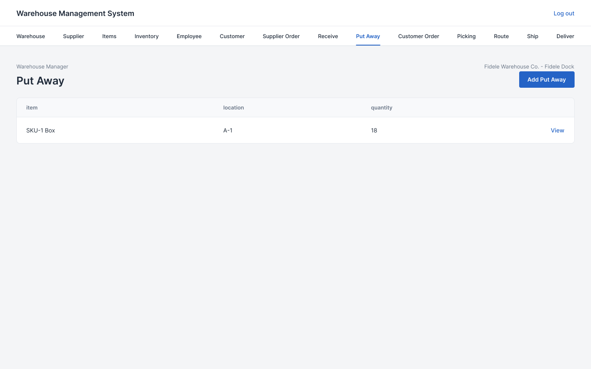
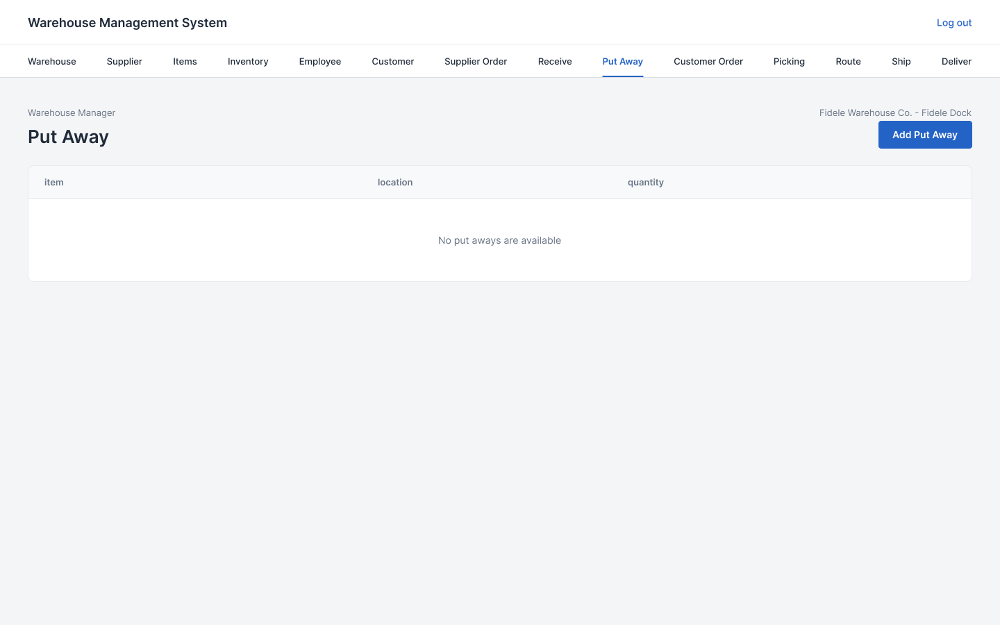
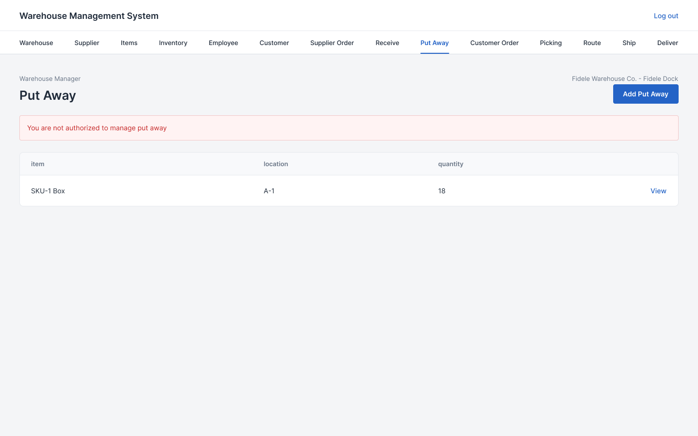
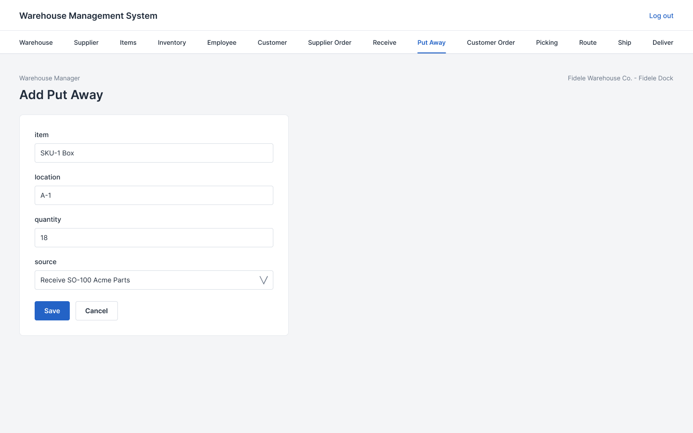
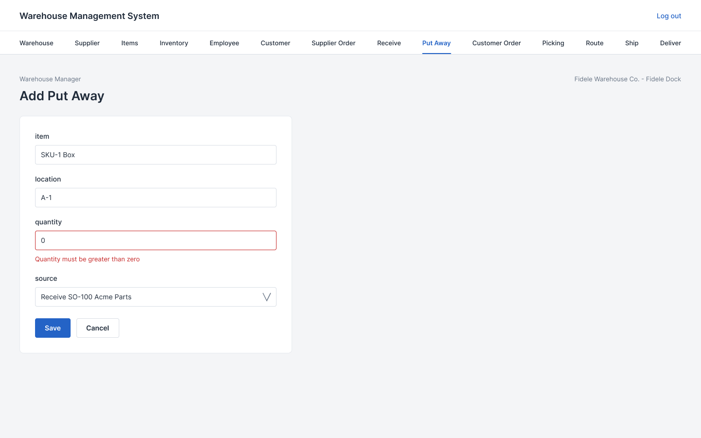
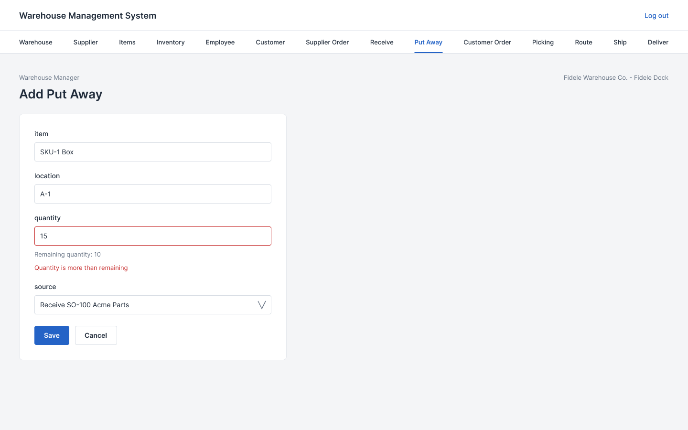
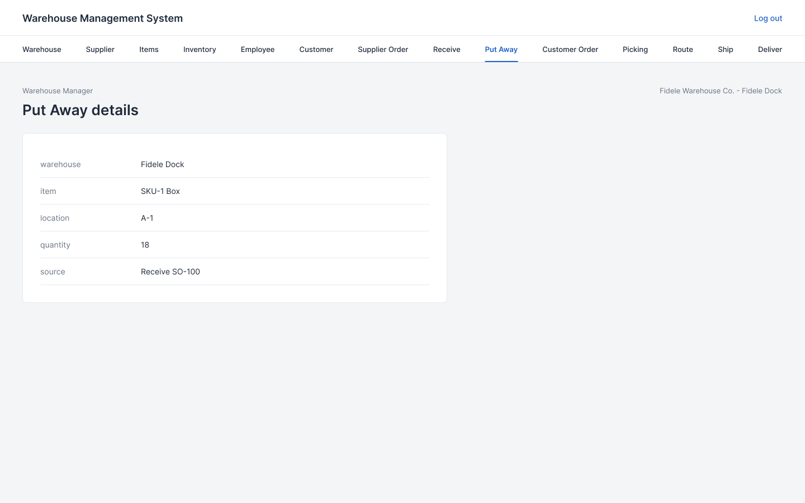

# Feature: Put Away

**Feature ID:**        N12  
**Branch pattern:**    `feature/12-put-away`  
**Status:**            Draft  
**Created:**           2026-19-10  
**Input:**             Putting received items into a warehouse location and updating inventory.
**Depends on:**        [Warehouse](feature_02_Warehouse__maintinence.md), [Items](feature_04_Items__maintinence.md), [Inventory](feature_05_Inventory__maintinence.md), [Supplier Order](feature_08_Supplier_order_Management.md), [Receiving](feature_11_receiving.md)
**Related:**           [Customer Order](feature_09_Customer_Order_Management.md), [Picking](feature_13_picking.md)
---

## User Stories

### US-N.12.1: View received lines not yet on a shelf
**As a**        Warehouse Manager
**I want to**   see received supplier-order lines that still have quantity not put away
**So that**     I know what must go to a warehouse location.
**Priority:**               P1  
**Independent test:**    Receive 50 of an item. View Put Away shows that item with remaining quantity 50.
**Acceptance scenarios:**   US-12.1: under the acceptance criteria

### US-N.12.2: Put received quantity onto a location
**As a**       Warehouse Manager
**I want to**  put a received quantity onto a warehouse location after the supplier order is Received
**So that**    stock in that warehouse goes up only when the item is on a shelf.

**Priority:**               P1  
**Independent test:**    Put away 20 of 50 received units into location A-12. The put away is saved, remaining to put away is 30, inventory increases by 20. Draft or Submitted orders cannot be put away. Quantity over remaining is rejected.
**Acceptance scenarios:**   US-12.2: under the acceptance criteria

### US-N.12.3: View put away records
**As a**       Warehouse Manager
**I want to**  View put away records
**So that**    I can see warehouse, item, quantity, and location.

**Priority:**               P1  
**Independent test:**   Complete a put away and select View Put Away records. The warehouse, item, quantity, and location are displayed.
**Acceptance scenarios:**   US-12.3: under the acceptance criteria

### US-N.12.4: Put away from a customer return
**As a**       Warehouse Manager
**I want to**  put returned retailer order items back into a warehouse location
**So that**    the inventory is updated after the items come back.

**Priority:**               P2  
**Independent test:**   Put away a returned item from a customer order. The inventory quantity increases.
**Acceptance scenarios:**   US-12.4: under the acceptance criteria

---

## Functional Requirements

- **FR-001**: System Must allow the warehouse Manager to view items that are ready to put away.
- **FR-002**: System Must allow an authorised Warehouse Manager to put away items from a Received supplier order into a warehouse location.
- **FR-003**: System Must update the inventory quantity when a put away is saved.
- **FR-004**: System Must associate each put away with a warehouse and an item.
- **FR-005**: System Must reject a put away when the supplier order is not Received.
- **FR-006**: System Must reject a put away quantity of zero or less.
- **FR-007**: System Must reject a put away quantity that is more than the quantity still not put away for that order item.
- **FR-008**: System Must allow an authorised Warehouse Manager to view put away records.
- **FR-009**: System Must prevent unauthorized users from creating a put away.

---

## Key Entities

- **Put Away**: moving items into a warehouse location so they are stored in inventory.
- **Supplier Order**: the order the items came from. A Received supplier order can have one or more put aways.
- **Customer Order**: a customer order can send items back to the warehouse to be put away.
- **Warehouse**: the location where the items are stored.
- **Item**: the inventory item being put away.
- **Inventory**: the stock quantity in the warehouse. Put away increases the quantity.

- **relationships**
- one **Supplier Order** can have multiple **Put Aways**
- one **Warehouse** can have multiple **Put Aways**
- one **Item** can be in multiple **Put Aways**

---

## Data Model Requirements

### `Put Away` table

 Field             
-------            
 `put_away_id`      : this is the unique id
 `put_away_code`    : this is the unique code for the put away
 `warehouse_code`   : this is the warehouse where the items are stored
 `item_id`          : this is the item being put away
 `quantity`         : this is the quantity put into the location
 `location`         : this is the place in the warehouse
 `supplier_order_code` : this is the supplier order the items came from when it is a supplier put away
 `customer_order_code` : this is the customer order the items came from when it is a return
 `created_at`       : this is the time when the put away was saved

---

## Acceptance Criteria

### US-N.12.1 — View items to put away

#### Scenario: View items ready to put away
*   **Given** a Received supplier order has items that are not all put away
*   **When**  the warehouse Manager selects View Put Away
*   **Then**  the system displays the items that still need to be put away
*   **And**   displays the remaining quantity for each item

#### Scenario: No items to put away
*   **Given** there are no items ready to put away
*   **When**  the warehouse Manager selects View Put Away
*   **Then**  the system displays "No items are available to put away"

### US-N.12.2 — Put away items

#### Scenario: Put away from a supplier order
*   **Given** the Warehouse Manager is authorized
*   **And**   a supplier order has status Received
*   **When**  the manager enters a valid warehouse location and quantity for an order item
*   **Then**  the system saves the put away
*   **And**   associates it with the warehouse and the supplier order
*   **And**   the inventory quantity of that item increases by the put away quantity

#### Scenario: Supplier order is not Received
*   **Given** a supplier order has status Draft or Submitted
*   **When**  the Warehouse Manager tries to put away items from that order
*   **Then**  the put away is not saved
*   **And**   the system displays "Supplier order is not Received"

#### Scenario: Invalid put away quantity
*   **Given** the Warehouse Manager is putting away items
*   **When**  the quantity is zero or less
*   **Then**  the put away is not saved
*   **And**   the system displays "Quantity must be greater than zero"

#### Scenario: Quantity more than remaining
*   **Given** a Received supplier order still has 10 units not put away
*   **When**  the Warehouse Manager tries to put away 15 units of that item
*   **Then**  the put away is not saved
*   **And**   the system displays "Quantity is more than remaining"

### US-N.12.3 — View put away records

#### Scenario: View existing put aways
*   **Given** put away records exist in the system
*   **When**  the warehouse Manager selects View Put Away records
*   **Then**  the system displays the put aways
*   **And**   displays the warehouse, item, quantity, and location

#### Scenario: No put away records
*   **Given** no put away records exist
*   **When**  the warehouse Manager selects View Put Away records
*   **Then**  the system displays "No put aways are available"

### US-N.12.4 — Put away from a customer return

#### Scenario: Put away returned items
*   **Given** items from a customer order are returned to the warehouse
*   **When**  the Warehouse Manager puts the items into a warehouse location
*   **Then**  the system saves the put away
*   **And**   associates it with the customer order
*   **And**   the inventory quantity of that item increases by the put away quantity

#### Scenario: Unauthorized update
*   **Given** the user is not authorized to manage put away
*   **When**  the user attempts to create a put away
*   **Then**  the put away is not saved
*   **And**   the system displays "You are not authorized to manage put away"

---

## Assumptions

- The user is logged in as Warehouse Manager.
- Put away places received items (or returned items) into a warehouse location.
- Inventory quantity goes up by the put away quantity.

---

## Edge Cases

- User is not authorized
- Put away from a customer return
- List is empty

---

## Success Criteria

- **SC-001**: Warehouse Manager can put items into a location after receive or a customer return.
- **SC-002**: Inventory quantity increases by the put away quantity.
- **SC-003**: Unauthorized user sees "You are not authorized to manage put away".

---

## Data Ownership & Isolation

Put away records belong to the warehouse.

| Rule | Requirement |
|------|-------------|
| **Read scope** | Warehouse Manager can view put away records |
| **Write scope** | Warehouse Manager can create a put away |
| **Create scope** | New put away is created by the signed-in Warehouse Manager |
| **Cross-user access** | Missing record → `404`. Forbidden → "You are not authorized to manage put away" |
| **UI scope** | Put Away menu after login |
| **Implementation** | Auth on `/api/put-aways` |

---

## API Requirements

Base path: `/api`. Errors: `{ "message": "..." }`. Auth: `Authorization: Bearer <token>`.

| Method | Endpoint | Auth | Purpose |
|--------|----------|------|---------|
| `GET` | `/api/put-aways` | Yes | List put aways |
| `GET` | `/api/put-aways/:id` | Yes | View one put away |
| `POST` | `/api/put-aways` | Yes | Record a put away |

**Create body:** `{ "item_id": 1, "location": "A-1", "quantity": 10, "receive_id": 1 }`  
**Unauthorized:** `401` `{ "message": "You are not authorized to manage put away" }`

---

## Screen Requirements

Menu after login: **Put Away**. Warehouse Manager. After receive: supplier goods go onto a shelf. Inventory goes up.

Pictures: [`docs/ui/feature-12/`](../docs/ui/feature-12/)

### Put away list
- Heading: Put Away
- Button: **Add Put Away**
- List: item, location, quantity

Empty: "No put aways are available"

Not allowed: "You are not authorized to manage put away"

### Add Put Away
- Fields: item, location, quantity, receive or customer return
- Buttons: **Save**, **Cancel**

Quantity zero or less: "Quantity must be greater than zero"

Quantity more than remaining: "Quantity is more than remaining"

### Put away details
- Shows item, location, quantity, and source

---

## Definition of Done

- [ ] Put away from receive and from customer return match the Gherkin
- [ ] Inventory quantity increases

---

## Out of Scope

- A retailer putting stock away in their own store
- Coding the app (that is later)

